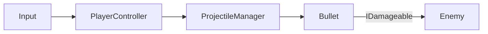

# Codebase Overview

This page is the map of a project's code: the first thing a new programmer reads before touching anything. It answers "where's the thing that does X?" and "how do the pieces fit?" Details belong on the system pages it links to. The [26-27 Game codebase docs](../../projects/2627-game/codebase/index.md) are a full example.

A codebase section usually has these pages:

| Page | Template | What's in it |
|---|---|---|
| Overview (this page) | Codebase Template | Architecture, folder map, conventions |
| `systems/<name>.md` | [System Template](system-template.md) | One system's behavior, class reference, and known issues |
| `how-to/<recipe>.md` | [How-To Template](how-to-template.md) | Step-by-step recipes for common changes |
| `tuning-guide.md` | (free-form) | Every asset designers can edit, with units and current values |
| `scripts/index.md` | (free-form) | A table of every script and the page that documents it |
| `milestones.md` | (free-form) | What each release added, and how to update the docs for the next one |

Include the project's milestone banner right under the title (see "Codebase docs" in the [Style Guide](../style-guide.md)):

```markdown
;--8<-- "includes/your-project/milestone.md"
```

---

## Running the Project

The Unity version, the scene to open, and anything that must be in that scene. Link to [Getting Set Up](../../tutorials/general/getting-set-up.md) instead of repeating it.

---

## Milestone N at a Glance

One row per system, saying what works and what's partial at this release. Link each row to that system's Known Issues:

| System | State at vX.Y.Z |
|---|---|
| [System Name](../../projects/2627-game/codebase/systems/index.md) | **Working.** What it does. |
| [Another System](../../projects/2627-game/codebase/systems/index.md) | **Partial.** What's missing. |

---

## Architecture

How the systems connect, and the few rules that hold everywhere (how input is read, how damage is dealt, where tuning numbers live). Draw the map in Mermaid with plain ASCII labels:



---

## What's in the Main Scene

A table of the root objects in the scene that ships, and the physics layers and tags the code depends on.

---

## Folder Map

| Folder | What's in it | Docs |
|---|---|---|
| `Assets/Player/` | Player scripts, prefabs, and data | [Player](../../projects/2627-game/codebase/systems/index.md) |
| `Assets/Plugins/` | Third-party code. Don't edit. | |

---

## Packages You'll See in Code

| Package | Used for | Where |
|---|---|---|
| Input System | Player input | `PlayerInputHandler` |

---

## Code Conventions

Link to the [C# Style Guide](../../tutorials/programming/csharp-style-guide.md), then list only what's specific to this project, such as namespaces.

---

## Picking Up Work

A short list of small, self-contained fixes from the Known Issues sections, and where to ask before starting one.

---

## Glossary

Project-specific terms, as a definition list:

```markdown
Ghost
:   What a player becomes in co-op at 0 HP while a teammate is still alive.
```
