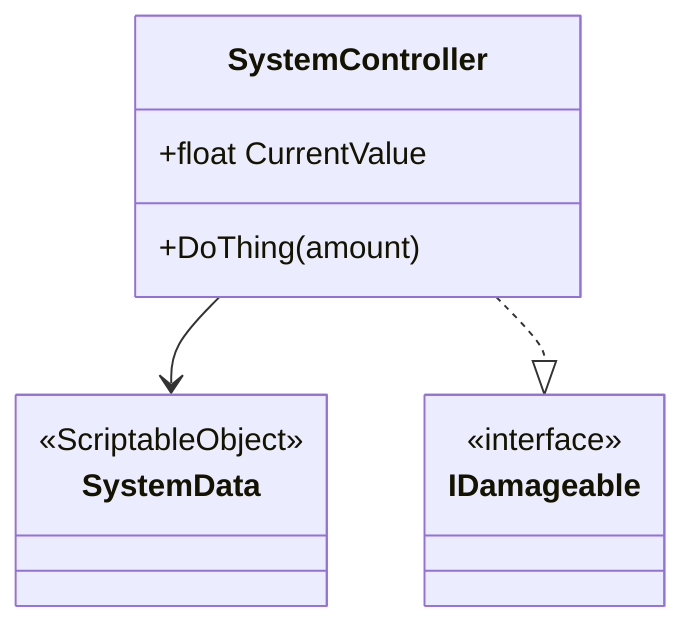
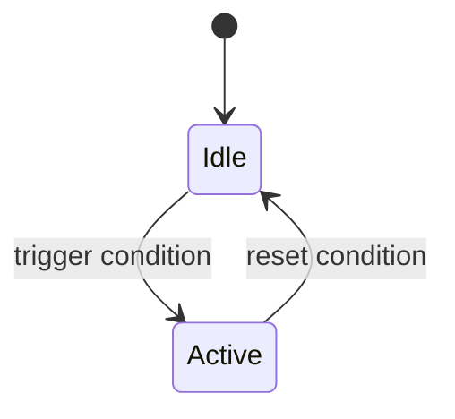

# System Name

If the project has a milestone banner, include it here, right under the title. See "Codebase docs" in the [Style Guide](../style-guide.md).

```markdown
;--8<-- "includes/your-project/milestone.md"
```

One specific paragraph on what this system is responsible for and how it does it. "Accelerates the player toward the held direction and caps speed at MaxVelocity" is better than "controls the player."

- **Folder:** [`Assets/YourSystem/`](https://github.com/PurdueSIGGD/your-project/tree/v0.1.0/Assets/YourSystem)
- **Namespace:** `YourNamespace` (or global)
- **Tuning:** link to the tuning guide section, if designers edit this system's assets

---

## How It's Put Together

A class diagram of the system's classes, the data assets they read, and the interfaces they implement. Keep labels plain ASCII.



A sentence or two on where these components live (which prefab, which object).

---

## How It Works

Explain what happens at runtime, in order, and why. Link to the source for the line-by-line details.

A state diagram helps wherever something changes state:



Use TeX for formulas, never Unicode math symbols:

$$
\text{damage} = \text{speed} \times \text{multiplier}
$$

---

## Class Reference

One subsection per class, in order of importance.

### `SystemController`

[`SystemController.cs`](https://github.com/PurdueSIGGD/your-project/blob/v0.1.0/Assets/YourSystem/SystemController.cs): `MonoBehaviour`; requires `Rigidbody2D`

One sentence on the class's job.

| Member | Type | Description |
|---|---|---|
| `data` | `SystemData` (Inspector) | Private `[SerializeField]` fields have (Inspector) after their type. |
| `CurrentValue` | `float` (get) | Properties say whether they're get-only. |
| `ValueChanged` | `event Action<float>` | When it's raised. |
| `DoThing(float amount)` | method | What it does, and who calls it. |

---

## Known Issues

Bugs, stubs, and behavior that would surprise a reader. Link each one to the line at the documented release when one line is at fault:

- **Short bold summary.** What goes wrong, and why. [Link to the line](https://github.com/PurdueSIGGD/your-project/blob/v0.1.0/Assets/YourSystem/SystemController.cs#L42).

### Differs from the GDD

Where the code doesn't match the Game Design Document yet. Leave this out if the project has no design doc.

- **Feature.** What the GDD says, then what the code does.
