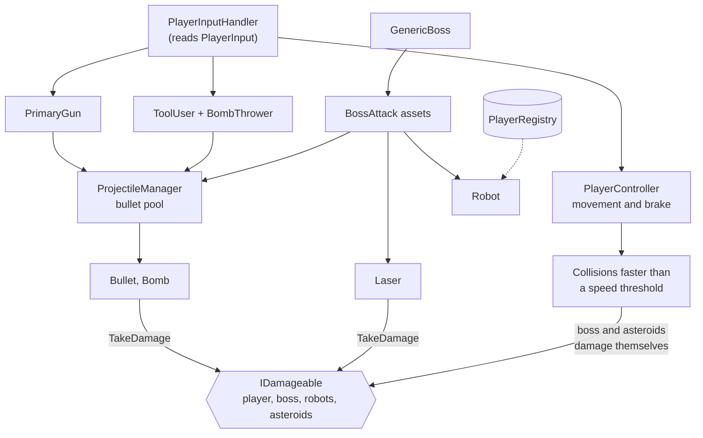

# Codebase Overview

--8<-- "includes/2627-game/milestone.md"

This section is the map of the [SIGGD-Game-2026](https://github.com/PurdueSIGGD/SIGGD-Game-2026) Unity project.

- [Systems](systems/index.md): reference for each system.
- [How-To](how-to/index.md): recipes for common changes.
- [Tuning Guide](tuning-guide.md): every value designers can change.
- [Script Index](scripts/index.md): every script and the page that covers it.
- [Glossary](#glossary): project-specific terms.

---

## Running the Project

1. Set up Unity Hub, Git, and the repo by following [Getting Set Up](../../../tutorials/general/getting-set-up.md).
2. Open the project with Unity **6000.3.21f1**.
3. Open `Assets/Scenes/MasterScene.unity`. It's the only scene in the build.
4. Press **Play**. Use the [controls on the Overview page](../index.md#controls).

You should see the player, the Factory Planet spinning, and seven test asteroids drifting. The planet starts attacking as soon as the scene loads.

`PlayerHealthTestScene` and `testplayermovement` in `Assets/Scenes/`, and `Test.unity` in `Assets/Equipment/LoadoutMenu/`, are test scenes. They aren't in the build and may be out of date.

---

## Milestone 1 at a Glance

| System | State at v0.1.0 |
|---|---|
| [Player](systems/player.md#known-issues) | **Working.** Movement, brake and relaunch, aiming, health with a short invincibility window after each hit. Co-op ghosts and revives work in code, but MasterScene only has one player. |
| [Damage and Health](systems/damage.md#known-issues) | **Working.** One interface shared by the player, boss, robots, and asteroids. |
| [Weapons and Projectiles](systems/weapons.md#known-issues) | **Working.** One gun (the Pistol) with pooled bullets. Fire rate isn't limited yet, and spline bullets are a work in progress. |
| [Tools](systems/tools.md#known-issues) | **Working.** The Bomb Thrower is the one tool. |
| [Loadout and Passives](systems/loadout.md#known-issues) | **Partial.** The loadout menu swaps guns. Tool swapping is stubbed out, and passives are stored but never applied. |
| [Boss](systems/boss.md#known-issues) | **Working.** The Factory Planet picks weighted random attacks (scrap fan, lasers, robots). It has one phase and no death sequence. |
| [Asteroids](systems/asteroids.md#known-issues) | **Built but not placed.** The full spawner, fragmenting, and pooling code exists, but no scene uses it yet. MasterScene uses seven simple test asteroids instead. |
| [Audio](systems/audio.md#known-issues) | **Working.** FMOD one-shots and boss music, through a generated `AudioEvents` class. |
| [Shared Infrastructure](systems/infrastructure.md#known-issues) | **Working.** Singletons, an event bus, and an object pool. Only the singleton runs in the game. `PrefabPool` waits on the asteroid system, and the event bus isn't used yet. |

---

## Architecture

Space Jam follows Unity's component model: each behavior is a small `MonoBehaviour`, and the numbers that tune it live in ScriptableObject assets. There's no central game manager yet. Systems find each other through prefab wiring, a few static entry points (`ProjectileManager.Instance`, `PlayerRegistry`, `AudioManager`), and the shared `IDamageable` interface.

*Arrows show who calls or creates what. Robots read `PlayerRegistry` to chase the nearest player, but don't deal damage yet. `AudioManager` isn't shown. The gun, the boss and its attacks, and the player all call it to play sounds.*

A few codebase rules:

- **Only `PlayerInputHandler` reads input.** Everything else reads its properties (`Move`, `IsBrakeHeld`) or subscribes to its events (`FirePressed`, `UseToolPressed`). See [Player](systems/player.md#input).
- **Anything that can be hurt implements `IDamageable`.** Attackers don't check what they hit. They build a `DamageContext` and call `TakeDamage`. The one exception is the MasterScene test asteroids, which check for the `Player` tag. See [Damage and Health](systems/damage.md).
- **Collision damage is computed by the thing being hit.** The boss and the asteroid system's asteroids each turn impact speed into damage to themselves. That's how "speed = damage" works in code.
- **Tuning numbers live in assets.** Guns, bullets, boss attacks, player stats, and asteroids all read from ScriptableObjects. See the [Tuning Guide](tuning-guide.md).
- **Sounds go through `AudioManager` and `AudioEvents`.** Do not type an FMOD path by hand. See [Audio](systems/audio.md).

---

## Physics Layers and Tags

The 2D collision matrix (**Project Settings > Physics 2D**) lets every layer hit every other layer. Bullets, robots, and ghosts then exclude specific layers on their own colliders, and anything on an excluded layer passes through them.

| Layer | Index | On it at v0.1.0 | Skipped by |
|---|---|---|---|
| `Asteroid` | 8 | The test asteroids | Ghost players |
| `Player` | 9 | The player prefab | The player's own bullets |
| `Enemy` | 10 | Nothing yet. Robots are still on `Default`. | Boss bullets, robots |
| `Boss` | 11 | The `Factory Boss` object | Boss bullets, robots |

Everything else, including robots, lasers, bullets, and bombs, is on `Default`.

Tags are listed as constants in `PlayerSystem.Tags`. `Player` is on the player prefab, and `Finish` marks whatever removes a ghost on contact (see [Player](systems/player.md#known-issues)).

---

## Folder Map

Everything game-specific is under `Assets/`. Folders are grouped by feature, not by file type, so a feature's scripts, prefabs, and data assets sit together.

| Folder | What's in it | Docs |
|---|---|---|
| `Assets/Player/` | Player components, `PlayerStats` asset, player prefabs and art. `PlayerHealthTesting/` holds the test asteroid and spawner. | [Player](systems/player.md) |
| `Assets/Damage/` | `IDamageable` and `DamageContext`. | [Damage and Health](systems/damage.md) |
| `Assets/Projectiles/` | `ProjectileManager`, `Bullet`, `PrimaryGun`, and the projectile assets in `Bullets/`. | [Weapons and Projectiles](systems/weapons.md) |
| `Assets/Equipment/` | Gun assets and prefabs, `Tools/` (tool scripts and assets), `LoadoutMenu/`, and an outdated `EquipmentManager/README.md`. | [Weapons and Projectiles](systems/weapons.md), [Tools](systems/tools.md), [Loadout and Passives](systems/loadout.md) |
| `Assets/PassiveFiles/` | The `Passive` asset type, `PassiveHolder`, and five passive assets. | [Loadout and Passives](systems/loadout.md) |
| `Assets/GenericBoss/` | Boss logic, the attack classes, and the Factory Planet's attack and weight assets. | [Boss](systems/boss.md) |
| `Assets/Boss/Factory Planet/` | The `Factory Boss` prefab and its art. | [Boss](systems/boss.md) |
| `Assets/PlanetRotation.cs` | The script that spins the boss, loose at the top of `Assets/`. | [Boss](systems/boss.md#planetrotation) |
| `Assets/Asteroids/` | The full asteroid system (not placed in a scene yet). | [Asteroids](systems/asteroids.md) |
| `Assets/Audio/` | `AudioManager`, the generated `AudioEvents.cs`, and its generator. | [Audio](systems/audio.md) |
| `Assets/Extensions/` | Reusable code with no game knowledge: `EventBus/` and `Singleton/`. | [Shared Infrastructure](systems/infrastructure.md) |
| `Assets/Input/` | `InputActions.inputactions`, the input map. | [Player](systems/player.md#input) |
| `Assets/UI/HUD/` | HUD prefab and sprites. | |
| `Assets/Scenes/` | `MasterScene` plus two old test scenes. | |
| `Assets/Plugins/` | Third-party code: FMOD, Odin Inspector, PrimeTween. | |
| `FMODProject/` (repo root) | The FMOD Studio project the audio team edits. | [Audio](systems/audio.md) |
| `FMOD/` (repo root) | Built FMOD banks that Unity loads. | [Audio](systems/audio.md) |

---

## Packages You'll See in Code

| Package | Used for | Where |
|---|---|---|
| [Input System](https://docs.unity3d.com/Packages/com.unity.inputsystem@1.20/manual/index.html) | All player input, through `PlayerInput` | `PlayerInputHandler` |
| [FMOD for Unity](https://www.fmod.com/docs/2.03/unity/welcome.html) | All audio | `AudioManager`, `AudioEvents` |
| [UniTask](https://github.com/Cysharp/UniTask) | `async` boss attacks and the attack loop | `GenericBoss`, `BossAttack*` |
| [Odin Inspector](https://odininspector.com/) | Showing read-only runtime values in the Inspector (`[ShowInInspector, ReadOnly]`) | `Player`, `GenericBoss` |
| [Splines](https://docs.unity3d.com/Packages/com.unity.splines@2.9/manual/index.html) | Work-in-progress curved bullet paths | `Bullet`, `ProjectileScriptableObject` |
| PrimeTween | Installed for tweening. No game script uses it yet. | |

---

## Code Conventions

The [C# Style Guide](../../../tutorials/programming/csharp-style-guide.md) covers naming and formatting, and the repo's `.editorconfig` mirrors it. Two project-specific notes:

- **Namespaces.** Most player code is in `PlayerSystem`, and the shared extensions are in `Extensions.EventBus` and `Extensions.Singleton`. Everything else is in the global namespace for now.
- **Unity 6 physics names.** The code uses `Rigidbody2D.linearVelocity` and `linearDamping`, the Unity 6 names for what used to be called `velocity` and `drag`.

---

## Glossary

Terms these pages use that are specific to Space Jam or to this codebase.

AOE bomb
:   The boss's area-of-effect bomb attack (`BossAttackBomb`). Built, but not in the Factory Planet's attack pool.

Brake and relaunch
:   The player's brake: hold to stop dead, release while holding a direction to fly off at the saved speed. See [Player](systems/player.md#braking-and-relaunch).

GDD
:   The [Game Design Document](../design/game-design-doc.md), the design team's source of truth for how the game should play.

Ghost
:   What a player becomes in co-op at 0 HP while a teammate is still alive. A ghost drifts toward the planet, and a living teammate can touch it to revive it. See [Player](systems/player.md#health-death-and-ghosts).

Invincibility window (i-frames)
:   The short time after a hit when the player can't be hurt again. Set by `IframeDuration`.

Kinematic
:   A `Rigidbody2D` that physics doesn't move. The boss is kinematic, so rams don't push it.

MasterScene
:   `Assets/Scenes/MasterScene.unity`, the one scene in the build.

Misc
:   The old name for the tool slot. It still appears in the GDD and some code comments.

Passive
:   The third loadout slot: a stat change with no button. See [Loadout and Passives](systems/loadout.md#passives).

Phase
:   A stage of a boss fight, set by the boss's health. Each phase can use different attack weights. See [Boss](systems/boss.md#phases).

Pool
:   A set of reusable objects that are switched off instead of destroyed. Bullets and asteroids are pooled. See [Shared Infrastructure](systems/infrastructure.md#prefabpool).

Scrap fan
:   The Factory Planet's basic bullet attack (`BossAttackLinearFan`).

Telegraph
:   A warning shown before an attack lands. The GDD asks for them, but none exist yet.

Weight
:   A number that sets how likely the boss is to pick an attack in a phase, stored in an `AttackPercents` asset. See [Boss](systems/boss.md#picking-an-attack).

World coordinates
:   Positions in the scene itself, not relative to any object. Boss attack origins use them.
