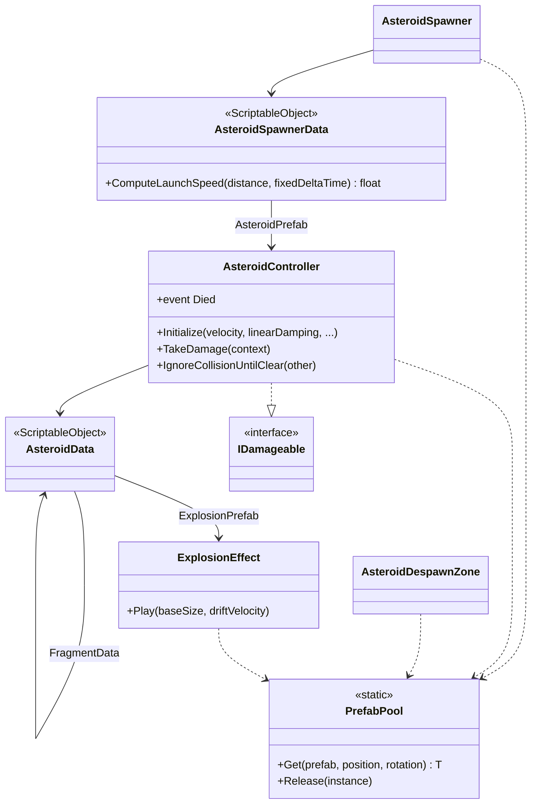
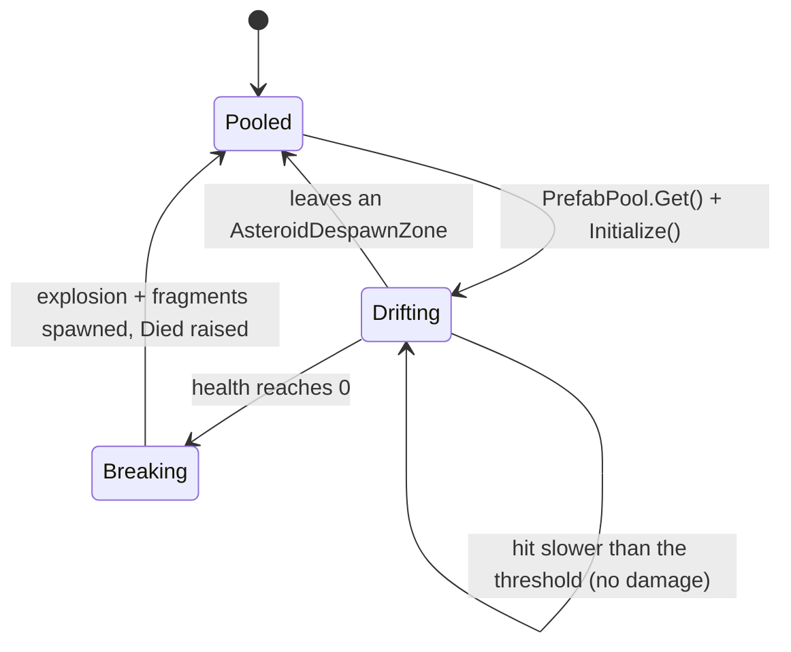

# Asteroids

--8<-- "includes/2627-game/milestone.md"

Asteroids are the ammunition of Space Jam: the GDD has players push them into the boss. The asteroid system spawns asteroids off-screen and drifts them into view, damages them by impact speed, and splits them into fragments that carry the parent's momentum. Everything is pooled.

!!! warning "Built, but not in the game yet"
    No scene or prefab uses `AsteroidSpawner` or `AsteroidController` at v0.1.0, and there are no `AsteroidData` assets yet. MasterScene uses seven simpler [test asteroids](#the-test-asteroids-in-masterscene) instead. Wiring this system into MasterScene is open work.

**Folder:** [`Assets/Asteroids/`](https://github.com/PurdueSIGGD/SIGGD-Game-2026/tree/v0.1.0/Assets/Asteroids) &nbsp;&middot;&nbsp; **Namespace:** global &nbsp;&middot;&nbsp; **Tuning:** [asteroids](../tuning-guide.md#asteroids)

---

## How It's Put Together

---

## How It Works

### Life of an Asteroid

Damage is applied in `OnCollisionEnter2D`, but the asteroid only breaks on its next `Update`, so new fragments never spawn in the middle of a physics callback.

### Spawning

Every `Period` seconds, `AsteroidSpawner`:

1. Picks a random **target point** inside the target area: the camera's view or the spawner's `BoxCollider2D`, shrunk by `TargetInset` on every side.
2. Picks a **direction of travel** within `Spread` degrees of `CenterAngle`. Here 0 is right and 90 is up.
3. Backs up from the target along that direction until it's outside the camera view plus `OffscreenMargin`, and at least `MinTravelDistance` away. That's the spawn point.
4. Launches the asteroid toward the target at a speed chosen so linear damping brings it to rest near the target point.

Unity's 2D physics scales velocity by $1 / (1 + c\,\Delta t)$ every physics step, where $c$ is the linear damping and $\Delta t$ is the fixed timestep. Treated as smooth exponential decay, that's a decay rate of $k = \ln(1 + c\,\Delta t) / \Delta t$, and an object decaying at rate $k$ from speed $v_0$ travels $v_0 / k$ before stopping. Setting that equal to the distance $d$ gives the launch speed `ComputeLaunchSpeed` returns:

$$
v_0 = d \cdot \frac{\ln(1 + c\,\Delta t)}{\Delta t}
$$

Because the physics actually runs in discrete steps, the asteroid stops slightly short: about 1% short at the default damping of 1, and about 5% short at a damping of 5.

### Impact Damage

Any collision faster than `speedDamageThreshold` damages the asteroid by the impact speed times `damageMultiplier`. It only damages itself; the boss works out its own damage from the same collision. See [Damage and Health](damage.md#who-deals-damage).

### Splitting

When an asteroid breaks, it spawns its `ExplosionPrefab` and `DebrisCount` fragments using `FragmentPrefab` and `FragmentData`. Fragments can split again if their own data has a `DebrisCount` above 0. `AsteroidData.OnValidate` reports an error if the chain of `FragmentData` loops back on itself.

Each of the $n$ fragments gets mass $m_f = m / n$ and scale $s / \sqrt{n}$, so the fragments' total area matches the parent's. They spawn spread evenly around the parent's center. Each one gets an outward impulse $\vec{J}_i$ of about `ExplosionImpulse`, randomized by `ImpulseVariationPercentage`, and then the average impulse is subtracted from all of them so they sum to exactly zero. Each fragment's velocity is

$$
\vec{v}_i = \vec{v}_{\text{parent}} + \frac{\vec{J}_i}{m_f}
$$

and because the impulses cancel, total momentum is unchanged:

$$
\sum_{i=1}^{n} m_f\,\vec{v}_i = m\,\vec{v}_{\text{parent}} + \sum_{i=1}^{n} \vec{J}_i = m\,\vec{v}_{\text{parent}}
$$

Fragments also inherit the parent's spin and damping. Freshly spawned fragments overlap, so each pair ignores collisions with each other until they're `siblingClearance` apart; otherwise they'd immediately damage each other.

### The Explosion Effect

`ExplosionEffect` is a pooled sprite that grows to `endScaleMultiplier` times its starting size and fades out along `alphaCurve` over `duration` seconds, moving at the dead asteroid's velocity. The default curve stays fully opaque for the first 30% of the effect, so the fragments underneath are hidden until the flash fades.

### The Test Asteroids in MasterScene

The seven asteroids in MasterScene come from `Assets/Player/PlayerHealthTesting/Asteroid.prefab`, which was built to test player health. Each one drifts in a random direction at 3 units/s and is destroyed 20 units from where it started, so about 7 seconds after the scene starts. Any collision destroys it, and if it hits a player, it deals that player 1 damage. That means touching one hurts you instead of pushing it, so you can't steer them into the boss yet. `Spawner.cs` in the same folder spawns them on a timer in `PlayerHealthTestScene`.

---

## Class Reference

Fields with (Inspector) after their type are private `[SerializeField]`s.

### `AsteroidController`

[`AsteroidController.cs`](https://github.com/PurdueSIGGD/SIGGD-Game-2026/blob/v0.1.0/Assets/Asteroids/Scripts/AsteroidController.cs) &middot; `MonoBehaviour`, `IDamageable` &middot; requires `Rigidbody2D` and `SpriteRenderer`, and warns in `OnValidate` if there's no `Collider2D`

| Member | Type | Description |
|---|---|---|
| `asteroidData` | `AsteroidData` (Inspector) | The prefab's own data. Fragments override it. |
| `speedDamageThreshold` | `float` (Inspector) | Impacts at or below this relative speed do nothing. `5` by default. |
| `damageMultiplier` | `float` (Inspector) | Damage per unit of impact speed. `10` by default. |
| `siblingClearance` | `float` (Inspector) | Gap fragments need before they collide with each other. `0.05` by default. |
| `CurrentHealth`, `MaxHealth`, `IsAlive` | (get) | From `IDamageable`. |
| `Died` | `event Action<AsteroidController>` | Raised once as the asteroid breaks, after fragments spawn. Cleared when the asteroid is disabled, so subscribe again after each `Get`. |
| `Initialize(Vector2 velocity, float linearDamping, AsteroidData dataOverride = null, float? massOverride = null, float? sizeOverride = null, float? angularVelocity = null)` | method | Reset and launch. Call right after `PrefabPool.Get`. Anything left `null` is rolled from the data. |
| `TakeDamage(DamageContext)` / `ResetHealth()` | methods | From `IDamageable`. |
| `IgnoreCollisionUntilClear(Collider2D other)` | method | Ignore collisions with `other` until the two separate. |

Turn **Use Auto Mass** off on the `Rigidbody2D`. With it on, the mass `Initialize` sets is ignored and fragments stop conserving momentum; `OnValidate` warns about this.

### `AsteroidData`

[`AsteroidData.cs`](https://github.com/PurdueSIGGD/SIGGD-Game-2026/blob/v0.1.0/Assets/Asteroids/Scripts/AsteroidData.cs) &middot; `ScriptableObject` &middot; **Create > Scriptable Objects > AsteroidData**

Read-only properties for every setting. The [Tuning Guide](../tuning-guide.md#asteroids) explains each one.

### `AsteroidSpawner`

[`AsteroidSpawner.cs`](https://github.com/PurdueSIGGD/SIGGD-Game-2026/blob/v0.1.0/Assets/Asteroids/Scripts/AsteroidSpawner.cs) &middot; `MonoBehaviour`

| Member | Type | Description |
|---|---|---|
| `asteroidSpawnerData` | `AsteroidSpawnerData` (Inspector) | What, how often, and from where. |
| `mainCamera` | `Camera` (Inspector) | Defines what counts as on-screen. Required. |
| `spawnBox` | `BoxCollider2D` (Inspector) | The target area when `BoundaryType` is `Collider`. |

The spawner disables itself with an error in the Console if its data, the data's prefab, or the camera is missing.

### `AsteroidSpawnerData`

[`AsteroidSpawnerData.cs`](https://github.com/PurdueSIGGD/SIGGD-Game-2026/blob/v0.1.0/Assets/Asteroids/Scripts/AsteroidSpawnerData.cs) &middot; `ScriptableObject` &middot; **Create > Scriptable Objects > AsteroidSpawnerData**

| Member | Type | Description |
|---|---|---|
| `SpawnBoundaryType` | `enum` | `Camera` (aim inside the camera view) or `Collider` (aim inside the spawner's `BoxCollider2D`). |
| `ComputeLaunchSpeed(float distance, float fixedDeltaTime)` | `float` | The launch speed that drifts a damped asteroid about `distance` units before stopping. |

Plus read-only properties for every setting, covered in the [Tuning Guide](../tuning-guide.md#asteroids).

### `AsteroidDespawnZone`

[`AsteroidDespawnZone.cs`](https://github.com/PurdueSIGGD/SIGGD-Game-2026/blob/v0.1.0/Assets/Asteroids/Scripts/AsteroidDespawnZone.cs) &middot; `MonoBehaviour` &middot; requires a `Collider2D` with **Is Trigger** on

Returns any asteroid that *leaves* its trigger to the pool. Size it to cover the play area plus the spawn margin.

### `ExplosionEffect`

[`ExplosionEffect.cs`](https://github.com/PurdueSIGGD/SIGGD-Game-2026/blob/v0.1.0/Assets/Asteroids/Scripts/ExplosionEffect.cs) &middot; `MonoBehaviour` &middot; requires `SpriteRenderer`

| Member | Type | Description |
|---|---|---|
| `duration` | `float` (Inspector) | Seconds the effect lasts. `0.6` by default. |
| `endScaleMultiplier` | `float` (Inspector) | Final size relative to starting size. `1.3` by default. |
| `alphaCurve` | `AnimationCurve` (Inspector) | Opacity over the effect's progress, 0 to 1. |
| `Play(float baseSize, Vector2 driftVelocity)` | method | Start the effect. Call right after `PrefabPool.Get`. |

`PrefabPool` is documented with [Shared Infrastructure](infrastructure.md#prefabpool).

---

## Extending

To get asteroids into a scene: make an asteroid prefab with `AsteroidController`, a `Rigidbody2D` (gravity 0, Use Auto Mass off), a collider, and the `FrictionlessSpace` physics material from `Assets/Asteroids/Data/`. Create an `AsteroidData` for it and a second one for its fragments (with `DebrisCount` 0), then an `AsteroidSpawnerData` pointing at the prefab. Add an `AsteroidSpawner` and an `AsteroidDespawnZone` to the scene.

Subscribe to `Died` to react to an asteroid breaking. The GDD's Asteroid Spawner passive and asteroid hostility (the boss turning idle asteroids against the player) both need a count of live asteroids, which `Died` and the spawner can provide.

---

## Known Issues

- **Not in any scene.** See the warning at the [top of this page](#asteroids).
- **The test asteroids can't be pushed.** They hurt the player on contact and destroy themselves, which is the opposite of what the GDD's asteroids do.
- **A stale doc comment.** `ComputeLaunchSpeed` says it makes the asteroid arrive in "`TimeToFlyIn` seconds", but there's no such setting. The formula stops the asteroid near the target; it doesn't control the travel time.
- **The spawn area never updates.** The camera and target rectangles are computed once in `Start`, so a camera that moves or zooms afterward leaves asteroids aimed at the old view.

### Differs from the GDD

- **Asteroid hostility isn't implemented.** That's the boss turning idle asteroids against the player.
