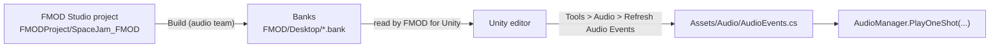

# Audio

--8<-- "includes/2627-game/milestone.md"

All game audio goes through [FMOD](https://www.fmod.com/docs/2.03/unity/welcome.html). The audio team builds events in FMOD Studio, and code plays them with one line, `AudioManager.PlayOneShot(AudioEvents.<path>)`. `AudioEvents` is a generated C# class with one field per FMOD event, so a typo in an event name is a compile error instead of a silent missing sound.

**Folder:** [`Assets/Audio/`](https://github.com/PurdueSIGGD/SIGGD-Game-2026/tree/v0.1.0/Assets/Audio) &nbsp;&middot;&nbsp; **Namespace:** global

---

## How It Works

### From FMOD Studio to Code



1. The audio team edits `FMODProject/SpaceJam_FMOD/SpaceJam_FMOD.fspro` in FMOD Studio and builds it.
2. The built banks (`Master`, `Master.strings`, `Music`, `Sound Effects`, `Voice Lines`) are committed under `FMOD/Desktop/` at the repo root. FMOD for Unity is set to read them from there (**FMOD > Edit Settings**, bank source `FMOD`), and copies them into `StreamingAssets/FMODBanks` when you build the game.
3. A programmer runs **Tools > Audio > Refresh Audio Events** in Unity, which rewrites `AudioEvents.cs` from the banks.
4. Code references the new field.

### The Generated `AudioEvents` Class

The generator turns each event path into nested static classes, one per FMOD folder, ending in a `static readonly EventReference`. For example, `event:/Sound Effects/Player/Misc/Player_Hurt` becomes:

```csharp
AudioEvents.Sound_Effects.Player.Misc.Player_Hurt
```

To make every path a legal C# name, the generator:

- replaces anything that isn't a letter, digit, or underscore with `_` (so `Sound Effects` becomes `Sound_Effects`),
- adds a leading `_` to names that start with a digit or are C# keywords,
- adds `_Event` to an event whose name matches a sibling folder, and `_2`, `_3`, and so on to duplicates.

Each field stores the event's GUID, which is what FMOD uses in a build. The readable path is only compiled into the editor, inside `#if UNITY_EDITOR`.

!!! warning "Don't edit `AudioEvents.cs` by hand"
    The next refresh overwrites it. If an event is missing, rebuild the banks in FMOD Studio and refresh.

### Events at v0.1.0

| Event (`AudioEvents.` ...) | Played by |
|---|---|
| `Sound_Effects.Player.Movement.Jetpack.Jetpack_Start` / `Jetpack_End` | `PlayerController`, when you start and stop holding a direction |
| `Sound_Effects.Player.Misc.Player_Hurt` | `PlayerHealth`, on every hit that lands |
| `Sound_Effects.Player.Gun.FirstGun.FirstGun_Shoot` / `FirstGun_CantShoot` | `PrimaryGun`, on firing or firing empty |
| `Sound_Effects.Boss_1.Attacks.Boss_1_ShootScrap` | `BossAttackLinearFan`, once per bullet |
| `Sound_Effects.Boss_1.Attacks.Boss_1_Laser` | `BossAttackLaser` |
| `Sound_Effects.Boss_1.Attacks.Boss_1_SpawnRobot` | `BossAttackRobotSpawn` |
| `Music.Boss_Music.Boss_1.Boss_1_Music` | `GenericBoss`, through `BossData.BossSoundTrack` |

These exist in the banks but nothing plays them yet: `Boss_1_BombExplode`, `Boss_1_BombTick`, `Boss_1_SpawnBomb`, `Boss_1_Hurt`, `Impact_Sound`, `Braking`, `Jetpack_Idle`, `UI_Click`, `MainMenu_Music`, and `Shop_Music`.

### Where Sounds Are Heard From

FMOD's `StudioListener` is on the Main Camera in MasterScene. `PlayOneShot` takes an optional world position, but every call at v0.1.0 leaves it out. That doesn't matter for 2D events, which ignore position. A 3D event would play as if it came from (0, 0), so pass `transform.position` for any event the audio team sets up as 3D in FMOD Studio.

---

## Class Reference

### `AudioManager`

[`AudioManager.cs`](https://github.com/PurdueSIGGD/SIGGD-Game-2026/blob/v0.1.0/Assets/Audio/AudioManager.cs) &middot; `MonoBehaviour` with only static members

You don't need an `AudioManager` in the scene; call its static methods from anywhere.

| Member | Type | Description |
|---|---|---|
| `PlayOneShot(EventReference audio, Vector3 position = default)` | `static` method | Fire-and-forget a sound at `position`. |
| `PlayTrack(EventReference audio)` | `static` method | Start a music track. Meant to stop the previous track first; see Known Issues. |

### `AudioEvents`

[`AudioEvents.cs`](https://github.com/PurdueSIGGD/SIGGD-Game-2026/blob/v0.1.0/Assets/Audio/AudioEvents.cs) &middot; generated `static class`

Nested static classes mirroring the FMOD folder tree, as described [above](#the-generated-audioevents-class).

### `AudioEventsGenerator` (editor only)

[`AudioEventsGenerator.cs`](https://github.com/PurdueSIGGD/SIGGD-Game-2026/blob/v0.1.0/Assets/Audio/Editor/AudioEventsGenerator.cs) &middot; `static class` in an `Editor` folder

| Member | Type | Description |
|---|---|---|
| `RefreshAudioEvents()` | `static` method, menu **Tools > Audio > Refresh Audio Events** | Read every event FMOD for Unity knows about and rewrite `AudioEvents.cs`. Leaves the file untouched if nothing changed, and logs the event count. |
| `BuildSource(IEnumerable<(string path, string guid)> events)` | `static string` | The text generation step on its own. Takes path and GUID pairs and returns the file's contents, without touching FMOD or the disk. |

---

## Extending

Follow [Add a Sound Effect](../how-to/add-a-sound.md). For music, give the boss's `BossData` a different `BossSoundTrack`.

---

## Known Issues

- **Music tracks stack.** [`PlayTrack`](https://github.com/PurdueSIGGD/SIGGD-Game-2026/blob/v0.1.0/Assets/Audio/AudioManager.cs#L19) creates the new instance in a local variable and never stores it in `currentMusicTrack`. The check that stops the previous track never finds one, so starting a second track plays both, and no track is ever released. Assign the new instance to `currentMusicTrack`.
- **No way to stop music.** There's no `StopTrack`, so music keeps playing after the boss dies.- **No call passes a position.** Any 3D event would play from the origin. See [above](#where-sounds-are-heard-from).
