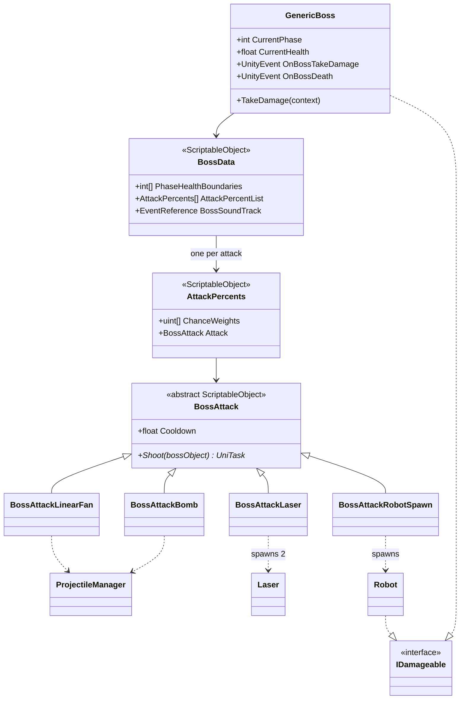
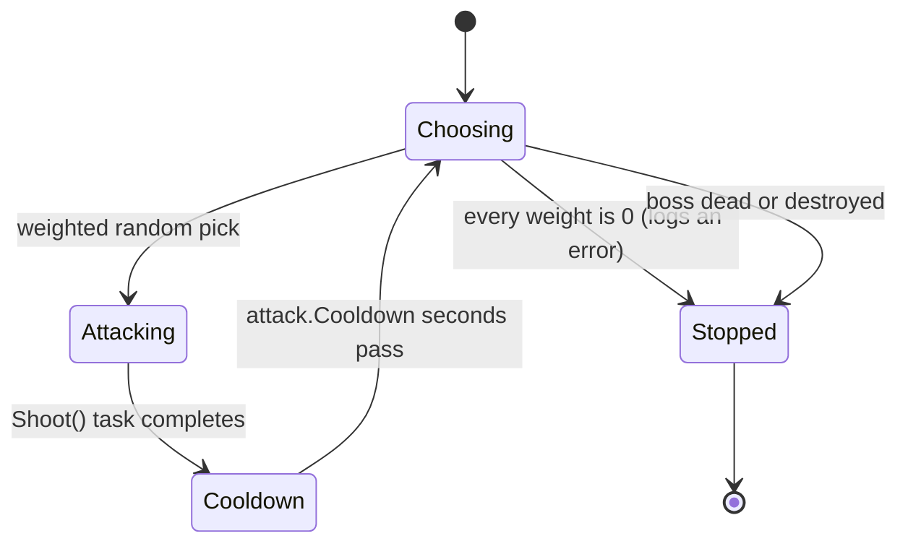

# Boss

--8<-- "includes/2627-game/milestone.md"

A boss is one `GenericBoss` component driven by a `BossData` asset. The boss loops forever: pick a weighted random attack for the current phase, wait for it to finish firing, wait out its cooldown, repeat. Attacks are ScriptableObject assets, so a new boss is mostly a new set of assets. The Factory Planet is the only boss at v0.1.0.

- **Folders:** [`Assets/GenericBoss/`](https://github.com/PurdueSIGGD/SIGGD-Game-2026/tree/v0.1.0/Assets/GenericBoss) (logic and the Factory Planet's attack assets), [`Assets/Boss/Factory Planet/`](https://github.com/PurdueSIGGD/SIGGD-Game-2026/tree/v0.1.0/Assets/Boss/Factory%20Planet) (the `Factory Boss` prefab and art)
- **Namespace:** global
- **Tuning:** [boss](../tuning-guide.md#boss)

---

## How It's Put Together

Three layers of assets describe a boss:

1. **`BossData`**, one per boss: health per phase, collision damage settings, music, and the list of attacks.
2. **`AttackPercents`**, one per attack in that list: which `BossAttack` to use, and a weight for each phase.
3. **`BossAttack`** subclasses, one per attack variant: the pattern (projectile, count, angles, timing).

The same `BossAttack` asset can appear in several bosses' lists with different weights.

### Names for the Same Attack

Each Factory Planet attack goes by several names, depending on whether you're reading the GDD, the code, or the Project window:

| In the GDD and these docs | Class | Attack asset | Weight asset |
|---|---|---|---|
| Scrap fan | `BossAttackLinearFan` | `BossAtkLinearFan.asset` | `BasicAttack.asset` (`BasicPercent.asset` is an unused duplicate) |
| Lasers | `BossAttackLaser` | `BossAttackLaser.asset` | `LaserAttack.asset` |
| Robot spawn | `BossAttackRobotSpawn` | `BossAttackRobotSpawn.asset` | `RobotSpawn.asset` |
| AOE bomb (not in use) | `BossAttackBomb` | `BossAttackBomb.asset` | `BombPercent.asset` (not in any list) |

---

## How It Works

### The Attack Loop

`GenericBoss.Start` fills health, starts the boss music with `AudioManager.PlayTrack`, and starts `AttackLoop`, an `async` [UniTask](https://github.com/Cysharp/UniTask) method.

`Shoot()` returns a task that completes once the attack has finished *firing*. Projectiles, lasers, and robots it created keep going after that.

The loop holds a cancellation token tied to the boss object, so destroying the boss stops the loop from waiting on the current attack or cooldown. `Shoot()` itself doesn't receive that token, though. An attack that awaits its own delays, like the scrap fan, keeps firing to the end even after the boss is gone.

### Picking an Attack

Each `AttackPercents` has a `ChanceWeights` array with one entry per phase. In phase `p`, an attack's chance is its `ChanceWeights[p]` divided by the sum of every attack's weight for `p`. Two extra rules:

- The attack used last time is excluded, so the boss doesn't repeat itself. If it's the only attack with weight above 0, it's allowed to repeat.
- A weight of `0` removes an attack from that phase.

For example, ignoring the no-repeat rule, weights of 3, 1, and 0 in phase 1 make the first attack fire 75% of the time and the third never fire.

### Phases

`PhaseHealthBoundaries` lists the health at which each phase starts, highest first. The first entry is also the boss's max health. With `[100, 60, 25]`:

| Health | Phase (`CurrentPhase`) |
|---|---|
| 100 down to 60 | 0 |
| Below 60 down to 25 | 1 |
| Below 25 | 2 |

The phase only moves forward, and a single big hit can skip a phase. Every `AttackPercents` in the boss's list needs a `ChanceWeights` entry for every phase, or picking an attack in a later phase reads past the end of the array.

### Taking Damage

`GenericBoss` implements [`IDamageable`](damage.md). Anything that collides with it faster than `SpeedDamageThreshold` (relative speed, in units per second) damages it for `speed x DamageMultiplier`. That's how rams and pushed asteroids hurt the boss. Player bullets and bombs hurt it through `TakeDamage` too. At 0 health, `IsAlive` turns false and `OnBossDeath` is raised. The attack loop checks `IsAlive` between attacks, so the boss finishes its current attack and cooldown before it stops.

### The Attack Types

All positions are **world coordinates**, not offsets from the boss. The `bossObject` parameter that `Shoot` receives isn't used yet. The attacks use different angle conventions, listed in the **Angles** column.

| Attack | What it does | Angles |
|---|---|---|
| `BossAttackLinearFan` | Fires `ProjectileCount` bullets one at a time from `Origin`, `Delay` ms apart. Each shot turns by `AngleOffset` degrees and moves the origin `HOffset` units along x. Plays the scrap sound per shot. | 0 = up, positive turns clockwise |
| `BossAttackBomb` | Fires `ProjectileCount` projectiles from `Origin`, `Delay` ms apart, aimed where the player will be in one second (position plus velocity). | Aimed, no angle field |
| `BossAttackLaser` | Spawns two `Laser` beams from `Origin`, at `LeftAngle` and `RightAngle`, each `Length` long. They hurt every `IDamageable` inside them for `Damage` once per second and vanish after `Lifetime` seconds. Finishes instantly. | 0 = right, positive turns counterclockwise |
| `BossAttackRobotSpawn` | Spawns `ProjectileCount` robots from `Origin`, `Delay` ms apart, launched in a fan like `LinearFan`. Each robot dashes at the nearest player every 3 seconds. | 0 = up, positive turns clockwise |

`Delay` is in **milliseconds** and `Cooldown` is in **seconds**.

### How a Laser Hits

A `Laser` is a trigger collider with no `Rigidbody2D`. `OnTriggerEnter2D` adds whatever enters it to a list, and `OnTriggerExit2D` removes it. A timer then damages everything in the list once per second. The timer starts at zero when the laser spawns, so nothing takes damage during the beam's first second.

### The Factory Planet at v0.1.0

| Setting | Value |
|---|---|
| Health and phases | 100 HP, one phase (`PhaseHealthBoundaries` = `[100]`) |
| Collision damage | Above 5 units/s relative speed, 10 damage per unit/s |
| Attacks (equal weight) | Scrap fan, lasers, robot spawn. The AOE bomb exists but isn't in the list. |
| Cooldown | 2 s after every attack (the default; no asset overrides it) |
| Music | `Boss_1_Music` |

The planet spins at 5 degrees per second through `PlanetRotation`. Its `Rigidbody2D` is kinematic, so collisions don't move it.

---

## Class Reference

### `GenericBoss`

[`GenericBoss.cs`](https://github.com/PurdueSIGGD/SIGGD-Game-2026/blob/v0.1.0/Assets/GenericBoss/GenericBoss.cs): `MonoBehaviour`, `IDamageable`

| Member | Type | Description |
|---|---|---|
| `bossData` | `BossData` (Inspector) | This boss's settings. |
| `OnBossTakeDamage` | `UnityEvent<DamageContext>` | Raised on every hit. No listeners on the `Factory Boss` prefab yet. |
| `OnBossDeath` | `UnityEvent<DamageContext>` | Raised when health reaches 0. No listeners yet. |
| `CurrentPhase` | `int` | Index of the current phase. Only `TakeDamage` changes it. |
| `CurrentHealth`, `MaxHealth`, `IsAlive` | (get) | From `IDamageable`. Shown read-only in the Inspector through Odin. |
| `TakeDamage(DamageContext)` | method | Subtract damage, update the phase, check for death. |
| `ResetHealth()` | method | Not implemented; throws. |

### `BossData`

[`BossData.cs`](https://github.com/PurdueSIGGD/SIGGD-Game-2026/blob/v0.1.0/Assets/GenericBoss/BossData.cs): `ScriptableObject`; **Create > Data > BossData**

Read-only properties `PhaseHealthBoundaries` (`int[]`), `SpeedDamageThreshold`, `DamageMultiplier`, `AttackPercentList` (`AttackPercents[]`), and the public field `BossSoundTrack` (`EventReference`).

### `AttackPercents`

[`AttackPercents.cs`](https://github.com/PurdueSIGGD/SIGGD-Game-2026/blob/v0.1.0/Assets/GenericBoss/AttackPercents.cs): `ScriptableObject`; **Create > Data > AttackPercents**

Read-only properties `ChanceWeights` (`uint[]`, one per phase) and `Attack` (`BossAttack`). It also declares a public constructor taking both. That constructor isn't usable, because Unity creates ScriptableObjects through the Create menu or `ScriptableObject.CreateInstance`.

### `BossAttack`

[`BossAttack.cs`](https://github.com/PurdueSIGGD/SIGGD-Game-2026/blob/v0.1.0/Assets/GenericBoss/BossAttack.cs): `abstract ScriptableObject`

| Member | Type | Description |
|---|---|---|
| `Cooldown` | `float` (get) | Seconds the boss waits after this attack finishes. `2` by default. |
| `Shoot(GameObject bossObject)` | `abstract UniTask` | Perform the attack. Complete the task when the attack is done firing. |

The four subclasses each add their own private serialized settings, listed in the [Tuning Guide](../tuning-guide.md#boss-attacks). `BossAttackLaser` also has a `Laser` field holding the beam prefab, `Assets/GenericBoss/Laser.prefab`. Their menu paths are **Create > Data > BossAttackLinearFan**, **BossAttackBomb**, **BossAttackLaser**, and **BossAttackRobotSpawn**.

### `Laser`

[`Laser.cs`](https://github.com/PurdueSIGGD/SIGGD-Game-2026/blob/v0.1.0/Assets/GenericBoss/Laser.cs): `MonoBehaviour`; prefab at `Assets/GenericBoss/Laser.prefab`

| Member | Type | Description |
|---|---|---|
| `InitLaser(float length, float angle, Vector2 origin, float damage, float lifetime)` | method | Place, rotate, and stretch the beam so it starts at `origin`, and set its damage and lifetime. The prefab's sprite must be 1 unit long, since the length is applied as x scale. |
| `OnTriggerEnter2D` / `OnTriggerExit2D` | methods | Unity callbacks that keep the list of targets. |

### `Robot`

[`Robot.cs`](https://github.com/PurdueSIGGD/SIGGD-Game-2026/blob/v0.1.0/Assets/GenericBoss/Robot.cs): `MonoBehaviour`, `IDamageable`; prefab at `Assets/Projectiles/Prefabs/Robot.prefab`

A robot takes its sprite, scale, collider shape, speed, and lifetime from a `ProjectileScriptableObject` (the `Robot` asset), like a bullet does. Its collider excludes the `Enemy` and `Boss` layers, so robots pass through the boss.

| Member | Type | Description |
|---|---|---|
| `maxHealth` | `float` (Inspector) | `10` by default. |
| `OnRobotTakeDamage`, `OnRobotDeath` | `UnityEvent<DamageContext>` | Raised on a hit and at 0 health. |
| `OnBulletHit` | `UnityEvent<GameObject>` | Raised when the robot collides with something. |
| `InitRobot(ProjectileScriptableObject, Transform firePoint, Vector2 shootDirection, float dashtime)` | method | Spawn setup. `dashtime` is seconds between dashes. |
| `TakeDamage`, `ResetHealth`, `CurrentHealth`, `MaxHealth`, `IsAlive` | | From `IDamageable`. A robot destroys itself at 0 health. |
| `GetDamage()` / `SetDamage(int)`, `GetLifetime()` / `SetLifetime(float)` | methods | Read or override damage and seconds left. |

### `PlanetRotation`

[`PlanetRotation.cs`](https://github.com/PurdueSIGGD/SIGGD-Game-2026/blob/v0.1.0/Assets/PlanetRotation.cs): `MonoBehaviour`

`SpinSpeed` (`float`, degrees per second) is applied once as the `Rigidbody2D`'s angular velocity in `Start`.

---

## Known Issues

- **Nothing happens when the boss dies.** The attack loop stops, but `OnBossDeath` has no listeners, so the planet sits idle. There's no victory sequence or return to a menu.
- **The laser breaks on non-damageable objects.** [`Laser`](https://github.com/PurdueSIGGD/SIGGD-Game-2026/blob/v0.1.0/Assets/GenericBoss/Laser.cs#L54) adds whatever `GetComponent<IDamageable>()` returns to its list, including `null` for non-damageable colliders such as the test asteroids. The [damage tick](https://github.com/PurdueSIGGD/SIGGD-Game-2026/blob/v0.1.0/Assets/GenericBoss/Laser.cs#L47) then throws a `NullReferenceException` on that entry, and nothing after it in the list takes damage.
- **Lasers last 500 seconds.** The Factory Planet's laser asset has `Lifetime` set to `500`. `Laser` counts it in seconds, so every laser attack leaves two beams on screen for over eight minutes. The value may have been meant as milliseconds.
- **Robots don't hurt the player.** `Robot` stores a damage value but never applies it. Touching one does nothing.
- **Robots are on the `Default` layer, not `Enemy`.** Layer masks that mention `Enemy` don't affect them.
- **Attacks ignore the boss's position.** Every origin is a world coordinate. The `Factory Boss` object sits at x = 28.8, but the scrap fan and robots fire from (1, 1).
- **`BossAttackBomb` targets one player.** It finds a target with `FindAnyObjectByType<Player>()` instead of `PlayerRegistry`. Its projectile (`BossBomb`) is also marked explosive, which `Bullet` doesn't support yet.
- **The scrap fan runs for 50 seconds.** The Factory Planet's fan fires 100 shots 500 ms apart, and the boss can't start another attack until it finishes.
- **Robot colliders may be empty in builds.** Robots build their collider from a projectile asset, the same way bullets do. See [Weapons and Projectiles](weapons.md#known-issues).
- **Leftover code and assets.** `BasicPercent.asset` duplicates `BasicAttack.asset`, `BombPercent.asset` isn't in any boss's list, and `BossAttack` declares four private fields its subclasses never use.
- **The boss can die more than once, and `ResetHealth` throws.** See [Damage and Health](damage.md#known-issues).

### Differs from the GDD

The [GDD's Factory Planet](../../design/game-design-doc.md) section describes more than v0.1.0 builds:

- **Two phases.** The code has one. The GDD's phase 2 adds accelerating robots, an aimed laser, and a splitting bomb.
- **Weights.** The GDD's phase 1 is scrap (high), robots (medium), bomb (medium), lasers (low). The code has scrap, lasers, and robots at equal weight, and no bomb.
- **Laser sway and telegraphs.** The GDD's lasers sway, and attacks get warning indicators. Neither exists yet.
- **Damage visuals.** The GDD shows boss health through tint and cracks instead of a bar. There's no health display yet.
- **Ranking and asteroid hostility aren't implemented.** Ranking grades the players at the end of a fight, and asteroid hostility is the boss turning idle asteroids against the player.
