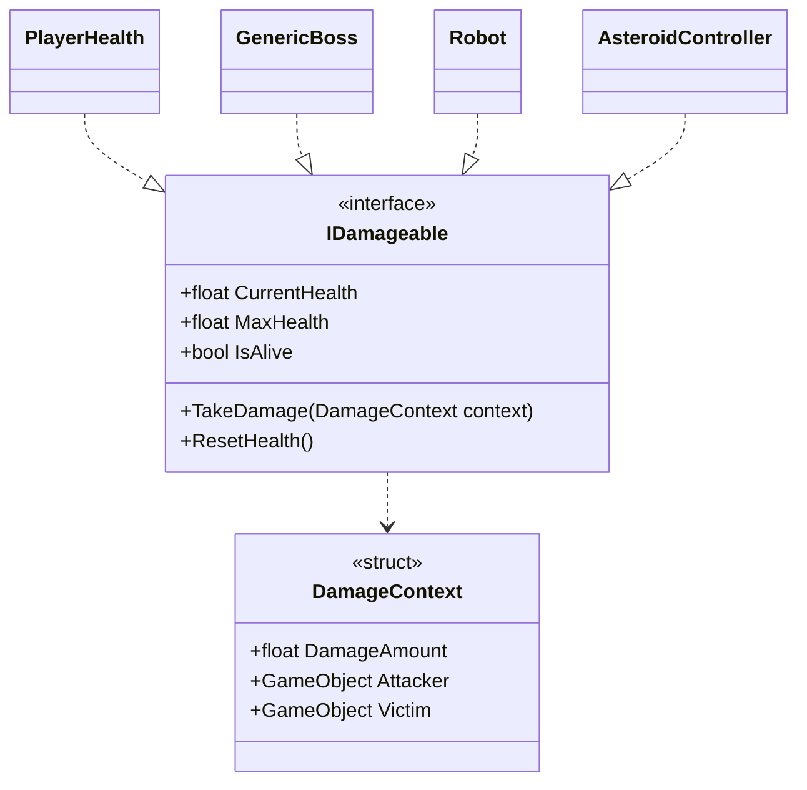

# Damage and Health

--8<-- "includes/2627-game/milestone.md"

Everything that can be hurt implements one interface, `IDamageable`. Anything that deals damage builds a `DamageContext` and calls `TakeDamage` on whatever it hit, without knowing whether that's a player, the boss, a robot, or an asteroid. Each damageable object decides for itself what a hit means.

**Folder:** [`Assets/Damage/`](https://github.com/PurdueSIGGD/SIGGD-Game-2026/tree/v0.1.0/Assets/Damage) &nbsp;&middot;&nbsp; **Namespace:** global

---

## How It's Put Together



---

## How It Works

### Who Takes Damage

| Implementer | What a hit does |
|---|---|
| [`PlayerHealth`](player.md#playerhealth) | Subtracts damage, then starts a short invincibility window and ignores hits during it. At 0 the player dies or becomes a ghost. |
| [`GenericBoss`](boss.md#genericboss) | Subtracts damage, raises `OnBossTakeDamage`, and moves to a later phase if health crossed a boundary. At 0 it raises `OnBossDeath`. |
| [`Robot`](boss.md#robot) | Subtracts damage. At 0 it raises `OnRobotDeath` and destroys itself. |
| [`AsteroidController`](asteroids.md#asteroidcontroller) | Subtracts damage. At 0 it explodes into fragments on its next `Update`. |

### Who Deals Damage

| Source | How it hits | Damage |
|---|---|---|
| [`Bullet`](weapons.md#bullet) | `OnTriggerEnter2D` with anything that has an `IDamageable` | The projectile asset's `Damage` |
| [`Laser`](boss.md#laser) | Every `IDamageable` inside its trigger, once per second | The laser attack's `Damage` |
| [`Bomb`](tools.md#bomb) | Every living `IDamageable` in its blast radius | `BombData.blastDamage` |
| Test `Asteroid` | `OnCollisionEnter2D` with the player | `1` |
| A collision with the boss or an asteroid | The boss or asteroid damages *itself* | Impact speed x a multiplier |

That last row is how the "speed = damage" pillar works. When something hits the boss faster than `SpeedDamageThreshold`, `GenericBoss` damages itself:

$$
\text{damage} = |\vec{v}_{\text{relative}}| \times \text{DamageMultiplier}
$$

`AsteroidController` uses the same formula with its own fields. Rams and pushed asteroids both work through this path: the boss computes its own collision damage, so neither the player nor the asteroid that hits it needs any damage-dealing code.

---

## Class Reference

### `IDamageable`

[`IDamageable.cs`](https://github.com/PurdueSIGGD/SIGGD-Game-2026/blob/v0.1.0/Assets/Damage/IDamageable.cs) &middot; `interface`

| Member | Type | Description |
|---|---|---|
| `CurrentHealth` | `float` (get) | Health right now. |
| `MaxHealth` | `float` (get) | Full health. |
| `IsAlive` | `bool` (get) | Whether the object can still take hits. |
| `TakeDamage(DamageContext)` | method | Apply a hit. |
| `ResetHealth()` | method | Return to full health, for restarting a fight. |

### `DamageContext`

[`IDamageable.cs`](https://github.com/PurdueSIGGD/SIGGD-Game-2026/blob/v0.1.0/Assets/Damage/IDamageable.cs) &middot; `struct`

| Field | Type | Description |
|---|---|---|
| `DamageAmount` | `float` | How much health to remove. |
| `Attacker` | `GameObject` | The object that caused the hit, such as a bullet, laser, or bomb. |
| `Victim` | `GameObject` | The object that was hit. |

Build one with the constructor or with an object initializer. Both styles appear in the code:

```csharp
// Constructor (Bullet.cs)
damageable.TakeDamage(new DamageContext(damage, gameObject, other.gameObject));

// Object initializer (GenericBoss.cs)
TakeDamage(new DamageContext
{
    DamageAmount = damageAmount,
    Attacker = collision.gameObject,
    Victim = gameObject
});
```

---

## Extending

To make something new damageable, implement `IDamageable` on a component on the object that owns the collider. `Bullet` and `Laser` look the interface up with `GetComponent`, which only searches that one object. `Bomb` uses `GetComponentInParent`, which also searches up the hierarchy.

To make something new deal damage, find the `IDamageable` on whatever you hit and call `TakeDamage`. Null-check the result, since most colliders in a scene aren't damageable.

---

## Known Issues

- **`GenericBoss.ResetHealth()` throws.** It's still [`NotImplementedException`](https://github.com/PurdueSIGGD/SIGGD-Game-2026/blob/v0.1.0/Assets/GenericBoss/GenericBoss.cs#L119), so anything that resets the fight through `IDamageable` crashes on the boss.
- **`Laser` doesn't null-check.** It adds whatever `GetComponent<IDamageable>()` returns, including `null`, so a non-damageable object inside a beam makes its damage tick throw. See [Boss](boss.md#known-issues).
- **No teams.** Nothing in `DamageContext` says who's on which side. Bullets avoid friendly fire through [collision layers](weapons.md#layers-who-a-bullet-can-hit) only. Lasers and bombs hurt every `IDamageable` they touch, and `GenericBoss` has a `TODO` to check whether the attacker is allowed to hurt it.
- **A 0-damage hit still counts.** `PlayerHealth` treats any `TakeDamage` call as a hit, even for 0 damage: it plays the hurt sound, slows the player, and starts the invincibility window. `GenericBoss` raises `OnBossTakeDamage` for it too.
- **The boss can "die" more than once.** `GenericBoss.TakeDamage` doesn't return early when already dead, so every hit after the killing blow raises `OnBossDeath` again.
- **Integer damage on projectiles.** `ProjectileScriptableObject.Damage` is an `int` while `DamageAmount` is a `float`, so bullets can't deal fractional damage.

### Differs from the GDD

- **Bullets hurt the boss.** The [GDD](../../design/game-design-doc.md) says bullets only clear projectiles and break asteroids. At v0.1.0, a player bullet deals its `Damage` to anything damageable, including the boss.
