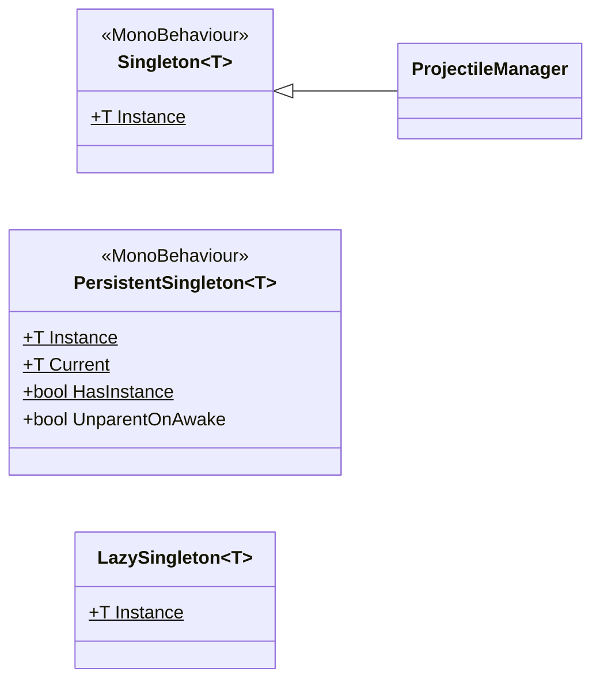

# Shared Infrastructure

--8<-- "includes/2627-game/milestone.md"

These pieces know nothing about Space Jam. They're general patterns the systems build on: singleton base classes, a type-safe event bus, and an object pool. At v0.1.0, only `Singleton<T>` runs in the game, through `ProjectileManager`. `PrefabPool` is used by the asteroid system, which isn't in a scene yet, and the event bus is ready but unused.

**Folders:** [`Assets/Extensions/`](https://github.com/PurdueSIGGD/SIGGD-Game-2026/tree/v0.1.0/Assets/Extensions), [`Assets/Asteroids/Scripts/PrefabPool.cs`](https://github.com/PurdueSIGGD/SIGGD-Game-2026/blob/v0.1.0/Assets/Asteroids/Scripts/PrefabPool.cs) &nbsp;&middot;&nbsp; **Namespaces:** `Extensions.Singleton`, `Extensions.EventBus`, and global for `PrefabPool`

---

## Singletons

Three base classes give a class one global instance reachable through `T.Instance`. They differ in what they wrap and what happens when no instance exists yet.



| | `Singleton<T>` | `PersistentSingleton<T>` | `LazySingleton<T>` |
|---|---|---|---|
| **Wraps** | A `MonoBehaviour` placed in the scene | A `MonoBehaviour`, placed or not | A plain C# class with a parameterless constructor |
| **If none exists** | `Instance` searches the scene (inactive objects included), logs a warning, and returns `null` | `Instance` searches the scene, then creates a GameObject named `<T>AutoCreated` | Created on first access |
| **Survives scene loads** | Yes, `DontDestroyOnLoad` | Yes, `DontDestroyOnLoad` | Not a scene object |
| **A second copy** | Destroyed in `Awake`, with a warning | Destroyed in `Awake` | Not prevented: `T` needs a public parameterless constructor, so `new T()` anywhere makes another |
| **Used by at v0.1.0** | `ProjectileManager` | Nothing | Nothing |

To use `Singleton<T>`, inherit from it with your own class as `T`. If you override `Awake` or `OnDestroy`, call the base method first, the way `ProjectileManager` does:

```csharp
public class ProjectileManager : Singleton<ProjectileManager>
{
    protected override void Awake()
    {
        base.Awake();
        // your setup
    }
}
```

`PersistentSingleton<T>` also has `UnparentOnAwake` (on by default), which detaches the object from its parent before marking it `DontDestroyOnLoad`, since Unity only keeps root objects across scene loads.

Reach for a singleton only when the whole game has exactly one of something. For anything per-player, like input or health, use components on the player and find them through [`PlayerRegistry`](player.md#playerregistry).

---

## EventBus

`EventBus<T>` lets one system announce something without knowing who's listening. Each event type gets its own static bus, so listeners for one event never see another.

1. Declare an event as a struct implementing `IEvent`, carrying whatever data listeners need.
2. Listeners wrap a handler in an `EventBinding<T>` and register it.
3. Anyone raises the event, and every registered binding runs its `OnEvent` and then its `OnEventNoArgs`.

```csharp
using Extensions.EventBus;
using UnityEngine;

public struct BossPhaseChanged : IEvent
{
    public int Phase;
}

public class PhaseMusic : MonoBehaviour
{
    EventBinding<BossPhaseChanged> binding;

    void OnEnable()
    {
        binding = new EventBinding<BossPhaseChanged>(OnPhaseChanged);
        EventBus<BossPhaseChanged>.Register(binding);
    }

    void OnDisable() => EventBus<BossPhaseChanged>.Deregister(binding);

    void OnPhaseChanged(BossPhaseChanged e) => Debug.Log($"Phase {e.Phase}");
}

// Somewhere else, when the phase changes:
EventBus<BossPhaseChanged>.Raise(new BossPhaseChanged { Phase = 1 });
```

`BossPhaseChanged` is an example; no game events exist yet. The only `IEvent` in the code is an empty `TestEvent`.

| Type | Members |
|---|---|
| [`EventBus<T>`](https://github.com/PurdueSIGGD/SIGGD-Game-2026/blob/v0.1.0/Assets/Extensions/EventBus/EventBus.cs) (`static class`, `T : IEvent`) | `Register(EventBinding<T>)`, `Deregister(EventBinding<T>)`, `Raise(T)`, `Clear()` |
| [`EventBinding<T>`](https://github.com/PurdueSIGGD/SIGGD-Game-2026/blob/v0.1.0/Assets/Extensions/EventBus/EventBinding.cs) | Constructors taking `Action<T>` or `Action` (for handlers that don't need the data); `Add` and `Remove` for either kind; public `OnEvent` and `OnEventNoArgs` delegates |
| [`IEvent`](https://github.com/PurdueSIGGD/SIGGD-Game-2026/blob/v0.1.0/Assets/Extensions/EventBus/Events.cs) | Marker interface, no members |
| [`EventBusEditorUtils`](https://github.com/PurdueSIGGD/SIGGD-Game-2026/blob/v0.1.0/Assets/Extensions/EventBus/EventBusEditorUtils.cs) (editor only) | Clears every bus when you exit Play mode, so stale bindings don't leak into the next run |

---

## PrefabPool

`PrefabPool` reuses instances of any prefab instead of destroying and instantiating them. Call `Get` where you'd call `Instantiate`, and `Release` where you'd call `Destroy`.

```csharp
AsteroidController asteroid = PrefabPool.Get(asteroidPrefab, spawnPosition, Quaternion.identity);
asteroid.Initialize(velocity, damping);   // a reused instance keeps its old state, so reset it

// later, instead of Destroy(asteroid.gameObject):
PrefabPool.Release(asteroid.gameObject);
```

| Member | Description |
|---|---|
| `Get<T>(T prefab, Vector3 position, Quaternion rotation)` (`T : Component`) | Returns an active instance of `prefab` at that pose, reusing a released one when possible. |
| `Release(GameObject instance)` | Deactivates the instance for reuse. An object that didn't come from `Get` is destroyed instead. Releasing the same object twice throws in the editor. |

There's one pool per prefab, created on first use. Each pool keeps up to 128 released instances, and any released past that are destroyed. Instances live under a `PrefabPoolRoot` object in the scene. When the scene unloads and takes that root with it, the next `Get` starts fresh pools.

### Two Pools in One Codebase

Bullets don't use `PrefabPool`. `ProjectileManager` owns its own `ObjectPool<GameObject>` for the one bullet prefab (see [Weapons and Projectiles](weapons.md#the-bullet-pool)). `PrefabPool` works for any prefab, so it's the one to use for new pooled objects.

---

## `Bootstrapper`

[`Bootstrapper.cs`](https://github.com/PurdueSIGGD/SIGGD-Game-2026/blob/v0.1.0/Assets/Extensions/EventBus/Bootstrapper.cs) is an empty `MonoBehaviour` in no scene. Its comment says it will initialize game systems.

---

## Known Issues

- **Bullets won't survive a scene reload.** `ProjectileManager` is `DontDestroyOnLoad`, but the bullets in its pool are root objects in the scene. Reloading the scene (which restarting a boss will likely do) destroys the bullets while the pool still holds them, so the next shot hands out a destroyed object. Parent pooled bullets under the manager, or clear the pool on scene load.
- **Changing bindings during `Raise` throws.** `EventBus<T>.Raise` loops over a `HashSet`, so registering or deregistering a binding for the same event from inside a handler throws `InvalidOperationException`.
