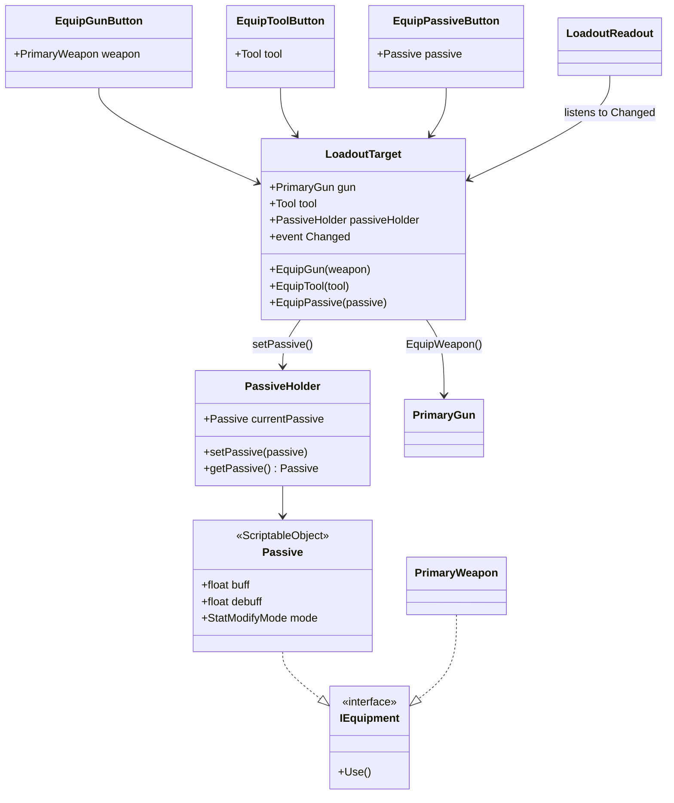

# Loadout and Passives

--8<-- "includes/2627-game/milestone.md"

The loadout menu lets a player pick a gun, a tool, and a passive before a fight. The whole menu is set up in the Inspector. Each button holds one choice, and a `LoadoutTarget` on the menu panel forwards clicks to that player's components. At v0.1.0 the gun slot works, the tool slot is stubbed out, and passives are stored but nothing applies them yet.

- **Folders:** [`Assets/Equipment/LoadoutMenu/`](https://github.com/PurdueSIGGD/SIGGD-Game-2026/tree/v0.1.0/Assets/Equipment/LoadoutMenu), [`Assets/PassiveFiles/`](https://github.com/PurdueSIGGD/SIGGD-Game-2026/tree/v0.1.0/Assets/PassiveFiles), [`Assets/Equipment/EquipmentManager/`](https://github.com/PurdueSIGGD/SIGGD-Game-2026/tree/v0.1.0/Assets/Equipment/EquipmentManager)
- **Namespace:** global
- **Tuning:** [passives](../tuning-guide.md#passives)

---

## How It's Put Together

---

## How It Works

### The Menu

1. A `LoadoutTarget` sits on the menu panel and holds references to one player's `PrimaryGun`, `Tool`, and `PassiveHolder`.
2. Each choice is its own button, a child of that panel. Gun and passive buttons hold an **asset** (a `PrimaryWeapon` or a `Passive`). A tool button holds a **component**: a reference to a `Tool` on that specific player, because tools are `MonoBehaviour`s, not assets.
3. In `Awake`, each equip button adds itself to the `Button` component's `onClick`. If `Equip` is also in the **On Click** list, each click equips twice.
4. On click, the button finds its `LoadoutTarget` (its own `target` field if set, otherwise the nearest parent) and calls `EquipGun`, `EquipTool`, or `EquipPassive`.
5. `LoadoutTarget` passes the choice to the player, then raises `Changed`.
6. Every button and `LoadoutReadout` listening to `Changed` refreshes: buttons turn their optional `equippedMarker` child on or off, and the readout writes the equipped names into its text labels.

For a second player, duplicate the whole menu and point the copy's `LoadoutTarget` at player 2. The copy's tool buttons still reference player 1's tool components.

Custom Inspectors in `LoadoutMenu/Editor/LoadoutMenuEditors.cs` draw a help box with setup steps on each of these components, so teammates can wire up a menu without reading the scripts.

### The Test Scene

The only scene with a loadout menu at v0.1.0 is `Assets/Equipment/LoadoutMenu/Test.unity`. It contains `Player.prefab`, a `ProjectileManager`, and a menu panel with equip buttons. One of its tool buttons points at a deleted asset.

### Passives

A `Passive` asset stores a description, a `buff`, a `debuff`, and a `StatModifyMode`. Its custom Inspector (`PassiveEditor`) spells out the intended rules:

- `buff` is a positive change to a stat and `debuff` is a negative one.
- `Flat` adds or subtracts the value directly; `Percent` scales the stat by that percentage.
- A passive that switches on a behavior instead of changing a number keeps both values at `0`, and other scripts check whether it's equipped.

`PassiveHolder` stores the equipped passive. The loadout menu reads it back for its markers and labels. No gameplay code reads it, so equipping a passive has no effect on play.

### `IEquipment`

`PrimaryWeapon` and `Passive` both implement `IEquipment`, whose single `Use()` method is meant for "what happens when this item is used". Both implementations are empty and nothing calls them. Gun firing and tool use go through `PrimaryGun` and `Tool` instead.

---

## Class Reference

### `LoadoutTarget`

[`LoadoutTarget.cs`](https://github.com/PurdueSIGGD/SIGGD-Game-2026/blob/v0.1.0/Assets/Equipment/LoadoutMenu/LoadoutTarget.cs): `MonoBehaviour`

| Member | Type | Description |
|---|---|---|
| `gun` | `PrimaryGun` | The player's gun component, on `WeaponHolder`. |
| `tool` | `Tool` | A tool component on the player. Left over from the older Misc design; see Known Issues. |
| `passiveHolder` | `PassiveHolder` | The player's passive holder. |
| `Changed` | `event Action` | Raised after every successful equip. |
| `EquipGun(PrimaryWeapon)` | method | Calls `gun.EquipWeapon`. |
| `EquipTool(Tool)` | method | Stubbed out; see Known Issues. |
| `EquipPassive(Passive)` | method | Calls `passiveHolder.setPassive`. |
| `IsCurrentGun(PrimaryWeapon)`, `IsCurrentTool(Tool)`, `IsCurrentPassive(Passive)` | `bool` | Whether that choice is equipped. Buttons use these for their markers. |
| `CurrentGunName()`, `CurrentToolName()`, `CurrentPassiveName()` | `string` | Display names for the readout, or `"None"`. |

### `EquipGunButton`, `EquipToolButton`, `EquipPassiveButton`

[`EquipGunButton.cs`](https://github.com/PurdueSIGGD/SIGGD-Game-2026/blob/v0.1.0/Assets/Equipment/LoadoutMenu/EquipGunButton.cs), [`EquipToolButton.cs`](https://github.com/PurdueSIGGD/SIGGD-Game-2026/blob/v0.1.0/Assets/Equipment/LoadoutMenu/EquipToolButton.cs), [`EquipPassiveButton.cs`](https://github.com/PurdueSIGGD/SIGGD-Game-2026/blob/v0.1.0/Assets/Equipment/LoadoutMenu/EquipPassiveButton.cs): `MonoBehaviour`; one per object

The three are identical apart from what they equip.

| Member | Type | Description |
|---|---|---|
| `weapon` / `tool` / `passive` | `PrimaryWeapon` asset / `Tool` component / `Passive` asset | What this button equips. |
| `target` | `LoadoutTarget` | Leave empty to use the nearest parent `LoadoutTarget`. |
| `equippedMarker` | `GameObject` | Optional child (a checkmark, say) shown while this item is equipped. |
| `Equip()` | method | Equip this button's choice. Called on click. |

### `LoadoutReadout`

[`LoadoutReadout.cs`](https://github.com/PurdueSIGGD/SIGGD-Game-2026/blob/v0.1.0/Assets/Equipment/LoadoutMenu/LoadoutReadout.cs): `MonoBehaviour`

| Member | Type | Description |
|---|---|---|
| `target` | `LoadoutTarget` | Leave empty to use the one on this object or a parent. |
| `gunLabel`, `toolLabel`, `passiveLabel` | `Component` | A legacy UI `Text` or a TextMeshPro text. Any other component logs a warning. |

### `Passive` and `StatModifyMode`

[`Passive.cs`](https://github.com/PurdueSIGGD/SIGGD-Game-2026/blob/v0.1.0/Assets/PassiveFiles/Passive.cs): `ScriptableObject`, `IEquipment`; **Create > Passives > Passive**

| Member | Type | Description |
|---|---|---|
| `description` | `string` (Inspector) | What the passive does, for designers. No public getter yet. |
| `buff` | `float` | Positive stat change. |
| `debuff` | `float` | Negative stat change. |
| `mode` | `StatModifyMode` | `Flat` or `Percent`. |

### `PassiveHolder`

[`PassiveHolder.cs`](https://github.com/PurdueSIGGD/SIGGD-Game-2026/blob/v0.1.0/Assets/PassiveFiles/PassiveHolder.cs): `MonoBehaviour`

| Member | Type | Description |
|---|---|---|
| `listOfPassive` | `List<Passive>` | Passives this player owns. Only read for a log message in `Start`. |
| `currentPassive` | `Passive` | The equipped passive. |
| `setPassive(Passive)` / `getPassive()` | methods | Set or read `currentPassive`. Lowercase `s` and `g`, unlike the rest of the codebase. |

### `IEquipment`

[`IEquipment.cs`](https://github.com/PurdueSIGGD/SIGGD-Game-2026/blob/v0.1.0/Assets/Equipment/EquipmentManager/IEquipment.cs): `interface`

One method, `void Use()`.

---

## Known Issues

- **Tool equipping is stubbed out.** The call in [`LoadoutTarget.EquipTool`](https://github.com/PurdueSIGGD/SIGGD-Game-2026/blob/v0.1.0/Assets/Equipment/LoadoutMenu/LoadoutTarget.cs#L59) is commented out, so clicking a tool button only raises `Changed`. `IsCurrentTool` returns `true` for every tool, so every tool marker lights up. `CurrentToolName` returns an empty string. `ToolUser` has no public getter for its current tool, and `Tool.data` is `protected`, so `LoadoutTarget` has no way to implement `IsCurrentTool` or `CurrentToolName` as it stands.
- **Passives do nothing.** No gameplay code reads `PassiveHolder`, and `Player.prefab` doesn't have a `PassiveHolder` on it.
- **The READMEs in `Assets/Equipment/` are out of date.** `EquipmentManager/README.md` and `LoadoutMenu/README.md` mention an Input Manager, `MiscGun.EquipMisc`, `EquipmentManager.cs`, and `PlayerEquipmentSystem`. None of those exist at v0.1.0. Input now goes through [`PlayerInputHandler`](player.md#input), and tools through [`ToolUser`](tools.md).
- **`Passive.debuff` has the wrong tooltip.** It reads "The number of additional asteroids spawned per wave", left over from the Spawner passive.
- **`PassiveHolder` imports `NUnit.Framework`.** It's a test-only namespace the class doesn't use.

### Differs from the GDD

- **No shop or locker.** The [GDD](../../design/game-design-doc.md) has a shop between fights and a locker screen for loadouts. The test menu is a stand-in for the locker.
- **Five of the GDD's passives exist as assets** (Asteroid Spawner, Coolant, HP Increase, Improved Thruster, Tungsten Cube), with no effect yet. The rest of the GDD's passive list has no assets.
