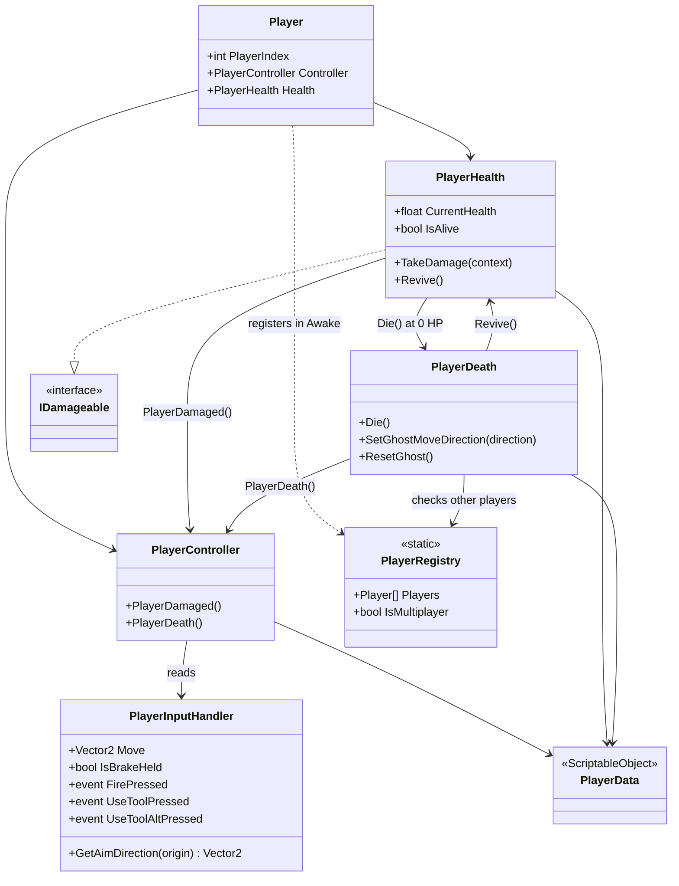
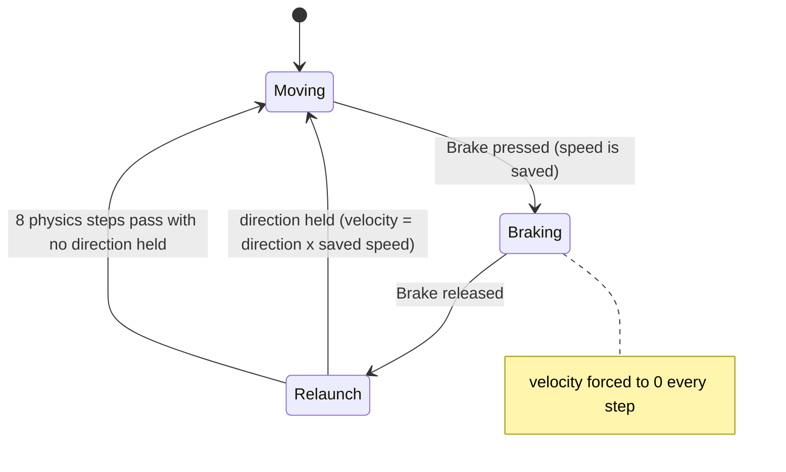
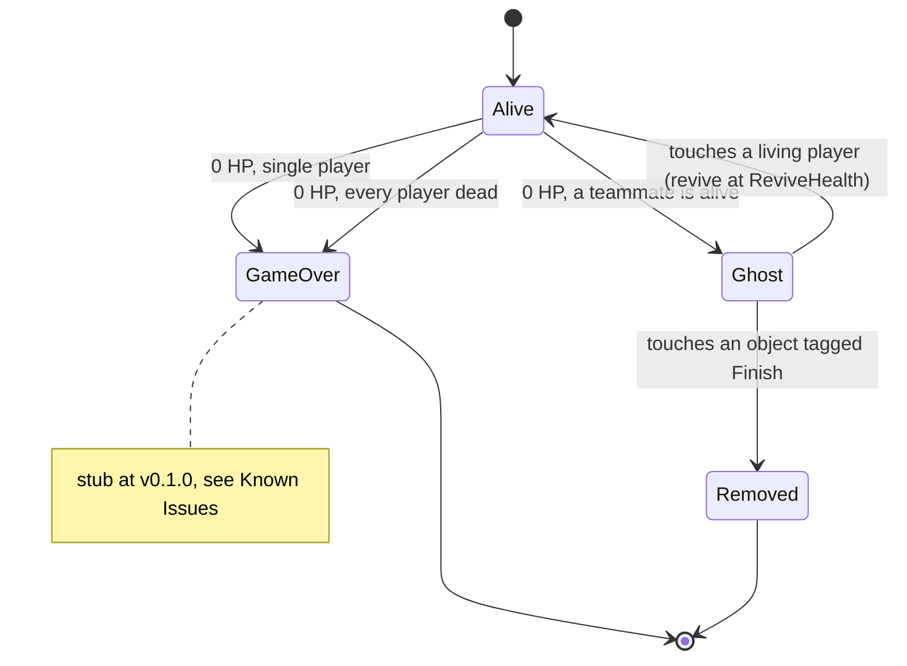

# Player

--8<-- "includes/2627-game/milestone.md"

The player is a zero-gravity `Rigidbody2D` that accelerates in the direction you hold, glides to a stop when you let go, and can brake to a dead stop and then relaunch at the speed it had. It has three hit points and a short invincibility window after each hit. In co-op, a dead player turns into a ghost that a teammate can revive.

- **Folder:** [`Assets/Player/`](https://github.com/PurdueSIGGD/SIGGD-Game-2026/tree/v0.1.0/Assets/Player)
- **Namespace:** `PlayerSystem` (except `PlayerAiming` and `PlayerAnimator`)
- **Tuning:** [`PlayerStats` asset](../tuning-guide.md#player)

---

## How It's Put Together

Every gameplay component lives on `Assets/Player/Player.prefab`. The `Player - Scope` prefab variant that MasterScene uses adds the character art on top, with `PlayerAnimator` and `PlayerAiming`.

`PlayerController`, `PlayerHealth`, and `PlayerDeath` each hold their own reference to the same `PlayerStats` asset.

---

## How It Works

### Movement

`PlayerController` reads `PlayerInputHandler.Move` in `Update` and applies forces in `FixedUpdate`. The input vector is normalized, so diagonals accelerate exactly as fast as cardinal directions, and a half-tilted stick counts as a full tilt.

Each physics step works like this:

1. **Holding a direction:** if the player was at rest and wasn't holding anything last step, apply a one-time `Impulse` to get moving. Then add `Acceleration` as a continuous force. The first step of input also plays the jetpack start sound.
2. **Not holding anything:** push against the current velocity with `Deceleration`. Because the push is capped so it can't overshoot, the player slides to an exact stop instead of jittering past zero. If the player is still moving on the first step after letting go, the jetpack end sound plays.
3. **Either way:** clamp speed to `MaxVelocity`.

The clamp runs at the end of `FixedUpdate`, but Unity applies the forces added during the step (thrust, the starting impulse, recoil) after it. So the player can go slightly over the cap. While holding a direction at top speed, they cruise at `MaxVelocity + Acceleration / Mass x 0.02`, which is 8.4 units/s with the shipped values. The next step clamps them back down before adding thrust again.

`linearDamping` is forced to `0` in `Awake`, so the only thing that slows the player is the deceleration force.

### Braking and Relaunch

The brake stops the player dead, holds them in place, and throws them back out at their old speed in whatever direction they're holding when they let go.

- On press, the current speed is saved if it's above 0.1.
- While held, velocity is set to zero every physics step.
- On release, the player has 8 physics steps (0.16 s at the project's 0.02 s fixed timestep) to hold a direction. The first step with input sets velocity to that direction times the saved speed.

### Input

`PlayerInputHandler` is the only script that talks to the Input System. It reads the `Player` action map of the `PlayerInput` component on the same object, and it exposes input in gameplay terms. Because every player prefab has its own `PlayerInput`, each player gets its own devices with no extra code.

| Action | Exposed as | Read by |
|---|---|---|
| `Move` | `Move` property | `PlayerController` |
| `Brake` | `IsBrakeHeld`, `WasBrakePressedThisFrame`, `WasBrakeReleasedThisFrame` | `PlayerController` |
| `Fire` | `FirePressed` event | `PrimaryGun` |
| `UseTool` | `UseToolPressed` event | `ToolUser` |
| `UseToolAlt` | `UseToolAltPressed` event, raised after the button is **held** for the Input System's default hold time (0.4 s) | `ToolUser` |
| `Aim` + `Point` | `GetAimDirection(origin)` | `PlayerAiming`, `RotateArmToAim` |
| `Previous` / `Next` | Not exposed | Nothing yet |

`GetAimDirection` checks the active control scheme. On `Keyboard&Mouse` it returns the direction from `origin` to the cursor's world position (through `Camera.main`). On a gamepad it returns the right stick direction. When the stick is centered it keeps returning the last direction, so the arm doesn't snap back to the right.

### Aiming

Two scripts rotate arms toward the aim direction:

- **`RotateArmToAim`** sits on the `Arm Rotate Point` object in `Player.prefab`. This is the one gameplay uses. The gun fires along this arm, and tools read its `AimDirection`. It's documented with [Weapons and Projectiles](weapons.md#rotatearmtoaim).
- **`PlayerAiming`** sits on the art in `Player - Scope`, and it's visual only. It runs in `LateUpdate` with `[DefaultExecutionOrder(100)]` so it rotates after `PlayerAnimator` flips the player. It rotates in the parent's local space so the arm stays correct while the player is mirrored.

### Health, Death, and Ghosts

`PlayerHealth` implements [`IDamageable`](damage.md). A hit plays the hurt sound, subtracts `DamageAmount`, and starts `IframeDuration` seconds of invincibility (often called i-frames). A hit that doesn't kill also calls `PlayerController.PlayerDamaged()`, which knocks `DamageSpeedDecrease` off the current speed, or off the saved brake speed while braking or relaunching. A hit for 0 damage still does all of this except subtracting health.

At 0 health, `PlayerDeath.Die()` stops the player and then branches on `PlayerRegistry.IsMultiplayer`:

A ghost drifts in a straight line (down by default) and stops colliding with the layers in `layersToIgnore` (the `Asteroid` layer on the prefab). Its speed starts at `BaseGhostSpeed` and grows by `DeathSpeedIncrease` each further time that same player dies.

Only movement stops while a player is dead. `PlayerController` skips its `Update` and `FixedUpdate` while `IsAlive` is false, but `PrimaryGun` and `ToolUser` don't check it. See [Known Issues](#known-issues).

---

## Class Reference

Fields with (Inspector) after their type are private `[SerializeField]`s you set on the prefab.

### `Player`

[`Player.cs`](https://github.com/PurdueSIGGD/SIGGD-Game-2026/blob/v0.1.0/Assets/Player/Player.cs): `MonoBehaviour`; requires `PlayerController`

The root component. Registers the player with `PlayerRegistry` in `Awake`, destroys the whole player object if the registry is full, and unregisters in `OnDestroy`.

| Member | Type | Description |
|---|---|---|
| `PlayerIndex` | `int` (get) | Slot in `PlayerRegistry.Players`, `0` or `1`. Shown read-only in the Inspector through Odin. |
| `Controller` | `PlayerController` (get) | This player's controller. |
| `Health` | `PlayerHealth` (get) | This player's health. |

### `PlayerController`

[`PlayerController.cs`](https://github.com/PurdueSIGGD/SIGGD-Game-2026/blob/v0.1.0/Assets/Player/PlayerController.cs): `MonoBehaviour`; requires `PlayerHealth`, `PlayerInputHandler`

Movement and braking, as described above.

| Member | Type | Description |
|---|---|---|
| `stats` | `PlayerData` (Inspector) | Movement numbers. |
| `rb` | `Rigidbody2D` (Inspector) | Falls back to `GetComponent` when empty. |
| `PlayerDamaged()` | method | Takes `DamageSpeedDecrease` off the current speed, or off the saved speed while braking or relaunching. Called by `PlayerHealth`. |
| `PlayerDeath()` | method | Zeroes velocity, saved speed, brake state, and input. Called by `PlayerDeath.Die()`. |

### `PlayerInputHandler`

[`PlayerInputHandler.cs`](https://github.com/PurdueSIGGD/SIGGD-Game-2026/blob/v0.1.0/Assets/Player/PlayerInputHandler.cs): `MonoBehaviour`; requires `PlayerInput`; one per object

| Member | Type | Description |
|---|---|---|
| `Move` | `Vector2` (get) | Raw movement input, -1 to 1 per axis. |
| `IsBrakeHeld` | `bool` (get) | Brake is down this frame. |
| `WasBrakePressedThisFrame` | `bool` (get) | Brake went down this frame. |
| `WasBrakeReleasedThisFrame` | `bool` (get) | Brake came up this frame. |
| `FirePressed` | `event Action` | Fire action performed. |
| `UseToolPressed` | `event Action` | Use Tool action performed. |
| `UseToolAltPressed` | `event Action` | Tool alternate action performed, which takes a 0.4 s hold. |
| `GetAimDirection(Vector2 origin)` | `Vector2` | Normalized aim direction from `origin`. Keeps the last direction when there's no aim input. |

### `PlayerHealth`

[`PlayerHealth.cs`](https://github.com/PurdueSIGGD/SIGGD-Game-2026/blob/v0.1.0/Assets/Player/PlayerHealth.cs): `MonoBehaviour`, `IDamageable`; requires `PlayerDeath`

| Member | Type | Description |
|---|---|---|
| `stats` | `PlayerData` (Inspector) | Health numbers. |
| `CurrentHealth` | `float` (get) | Starts at `MaxHealth`. |
| `MaxHealth` | `float` (get) | From `stats.MaxHealth`. |
| `IsAlive` | `bool` (get) | `CurrentHealth > 0`. |
| `TakeDamage(DamageContext)` | method | Ignored while dead or invincible. Otherwise plays the hurt sound, subtracts damage, then calls `Die()` or `PlayerDamaged()`, and starts the invincibility window. |
| `Revive()` | method | Sets health to `ReviveHealth`, only if health is exactly `0`. |
| `ResetHealth()` | method | Sets health back to `MaxHealth`. Meant for restarting a level. |

### `PlayerDeath`

[`PlayerDeath.cs`](https://github.com/PurdueSIGGD/SIGGD-Game-2026/blob/v0.1.0/Assets/Player/PlayerDeath.cs): `MonoBehaviour`

| Member | Type | Description |
|---|---|---|
| `stats` | `PlayerData` (Inspector) | Ghost numbers. |
| `layersToIgnore` | `LayerMask` (Inspector) | Layers a ghost passes through. `Asteroid` on the prefab. |
| `Die()` | method | Stops the player, then either calls game over or turns the player into a ghost. Called by `PlayerHealth`. |
| `SetGhostMoveDirection(Vector2)` | method | Sets the ghost's drift direction, for planets placed on other sides of the screen. Defaults to down. |
| `ResetGhost()` | method | Clears ghost speed and state, and restores collisions. |

### `PlayerData`

[`PlayerData.cs`](https://github.com/PurdueSIGGD/SIGGD-Game-2026/blob/v0.1.0/Assets/Player/PlayerData.cs): `ScriptableObject`; **Create > Player > Stats**

Read-only properties for every stat: `MoveSpeed`, `Mass`, `Acceleration`, `Deceleration`, `MaxVelocity`, `Impulse`, `MaxHealth`, `ReviveHealth`, `IframeDuration`, `DamageSpeedDecrease`, `BaseGhostSpeed`, `DeathSpeedIncrease`. The [Tuning Guide](../tuning-guide.md#player) explains each one and gives the shipped values.

### `PlayerRegistry`

[`PlayerRegistry.cs`](https://github.com/PurdueSIGGD/SIGGD-Game-2026/blob/v0.1.0/Assets/Player/PlayerRegistry.cs): `static class`

| Member | Type | Description |
|---|---|---|
| `MaxPlayers` | `const int` | `2`. |
| `Players` | `Player[]` (get) | Length `MaxPlayers`. Empty slots are `null`. |
| `PlayerCount` | `int` (get) | Registered players. |
| `IsMultiplayer` | `bool` (get) | `PlayerCount > 1`. |
| `RegisterPlayer(Player)` | `int` | Puts the player in the first free slot and returns its index, or `-1` when full. Called by `Player.Awake`. |
| `UnregisterPlayer(Player)` | method | Frees the player's slot. Called by `Player.OnDestroy`. |

### `Tags`

[`Tags.cs`](https://github.com/PurdueSIGGD/SIGGD-Game-2026/blob/v0.1.0/Assets/Player/Tags.cs): `static class`

String constants for `CompareTag`: `Tags.Player` and `Tags.Finish`.

### `PlayerAiming`

[`PlayerAiming.cs`](https://github.com/PurdueSIGGD/SIGGD-Game-2026/blob/v0.1.0/Assets/Player/PlayerAiming.cs): `MonoBehaviour`; global namespace

| Member | Type | Description |
|---|---|---|
| `CanLook` | `bool` | Set to `false` to freeze the arm. |
| `spriteAngleOffset` | `float` (Inspector) | Degrees added so the arm sprite points the right way. `180` by default. |

### `PlayerAnimator`

[`PlayerAnimator.cs`](https://github.com/PurdueSIGGD/SIGGD-Game-2026/blob/v0.1.0/Assets/Player/PlayerAnimator.cs): `MonoBehaviour`; requires `Animator`; global namespace

Sets the Animator float `CharVelocity` to the current speed every frame. It also faces the player left or right from the sign of the horizontal velocity, by rotating the object it's on 180 degrees around Y. In `Player - Scope` that's the root, so the whole player flips, arm and `WeaponHolder` included. No public members.

---

## Known Issues

- **Single-player game over does nothing.** [`GameOver()`](https://github.com/PurdueSIGGD/SIGGD-Game-2026/blob/v0.1.0/Assets/Player/PlayerDeath.cs#L123) only clears ghost state. The dead player stops moving and the fight keeps going.
- **Dead players can still shoot.** `PrimaryGun` and `ToolUser` don't check `IsAlive`, so a dead player or a ghost can fire and throw bombs. With `PlayerController` skipped there's no deceleration or speed cap, so recoil leaves a dead player drifting.
- **Ghosts are never removed in MasterScene.** Touching an object tagged [`Finish`](https://github.com/PurdueSIGGD/SIGGD-Game-2026/blob/v0.1.0/Assets/Player/PlayerDeath.cs#L53) removes a ghost, but nothing in MasterScene has that tag, including the Factory Boss, so ghosts drift off-screen forever.
- **Co-op can't start from MasterScene.** The scene has one player and no `PlayerInputManager`, so a second player has to be placed by hand to test co-op.
- **Two `PlayerData` tooltips are wrong.** `Impulse` says "Not currently used", but [`PlayerController` uses it](https://github.com/PurdueSIGGD/SIGGD-Game-2026/blob/v0.1.0/Assets/Player/PlayerController.cs#L90). `Mass` says it doesn't affect acceleration, but acceleration and the starting impulse are both divided by mass. Only deceleration ignores it.
- **A saved brake speed can linger.** If you release the brake without holding a direction within 8 physics steps, the player stays stopped and keeps the saved speed. The next brake from a standstill doesn't overwrite it, so the next relaunch uses the old speed.

### Differs from the GDD

- **Brake.** The [GDD](../../design/game-design-doc.md) brake slows to a tenth of speed (bullet time), drains 33% of saved speed per second, costs 10% on repeated brakes, and relaunches toward the aim direction. The code stops dead, has no drain or cost, and relaunches toward the movement input.
- **Speed cap.** The GDD discusses a soft cap where holding a direction keeps adding speed more slowly. The code clamps to `MaxVelocity` every step.
- **Getting hit.** The GDD also displaces the player away from the attacker. The code only reduces speed.
- **Ghost speed.** The GDD speeds ghosts up for every death in the match. The code tracks deaths per player.
- **Escape and terminal velocity aren't implemented.** These are the GDD's two speed thresholds for ramming a boss: one to deal damage, one to kill it outright. The GDD rule that touching a boss below escape velocity damages the player isn't implemented either.
