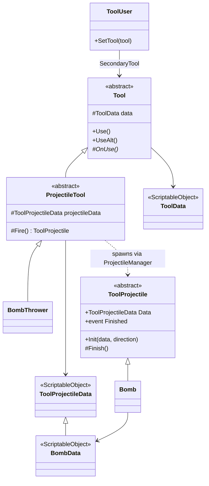

# Tools

--8<-- "includes/2627-game/milestone.md"

A tool is the equipment on right click. The [GDD](../../design/game-design-doc.md) and some older code call this the **Misc** slot; players see "tool". Every tool is a `Tool` component with a cooldown, and `ToolUser` forwards the two tool buttons to whichever `Tool` is equipped. The Bomb Thrower is the only tool at v0.1.0. Grapples, magnets, and portals come later.

- **Folder:** [`Assets/Equipment/Tools/`](https://github.com/PurdueSIGGD/SIGGD-Game-2026/tree/v0.1.0/Assets/Equipment/Tools)
- **Namespace:** global
- **Tuning:** [tools](../tuning-guide.md#tools)

---

## How It's Put Together

`ToolUser` and `BombThrower` both sit on the `WeaponHolder` object in `Player.prefab`. A projectile tool reads two assets: `ToolData` for the tool itself (its cooldown), and `ToolProjectileData` for what it throws.

---

## How It Works

### Using a Tool

1. `ToolUser` subscribes to `PlayerInputHandler.UseToolPressed` and `UseToolAltPressed`.
2. A press of the tool button calls `Use()` on the equipped tool. **Holding** the alternate button for 0.4 s calls `UseAlt()`, because that input action uses a Hold interaction.
3. `Tool.Use()` checks the cooldown. If it's ready, it starts the next cooldown from `ToolData.cooldown` and calls the subclass's `OnUse()`.
4. `UseAlt()` is a virtual method that does nothing unless a tool overrides it. It has no cooldown of its own.

### Projectile Tools

`ProjectileTool` is the base for tools that throw something. Its `Fire()` asks `ProjectileManager.ShootToolProjectile` to instantiate `projectileData.prefab` at `firePoint`, aimed along the `RotateArmToAim.AimDirection` of its `armRotatePoint`, and returns the new `ToolProjectile`. Tool projectiles aren't pooled. They're created on use and destroyed by `Finish()`.

### The Bomb

`BombThrower.OnUse()` calls `Fire()`. The `Bomb` it throws moves at `speed` along the aim direction and explodes after `fuseTime` seconds. The explosion:

1. Finds every collider within `blastRadius`.
2. Damages each living `IDamageable` it finds (searching up from the collider) once, for `blastDamage`.
3. Pushes each dynamic `Rigidbody2D` once, away from the blast center, with an impulse that falls off with distance:

$$
J = \text{blastImpulse} \times \frac{d_{\min}}{\max(d,\ d_{\min})}
$$

where $d$ is the distance from the blast to the nearest point of the collider and $d_{\min}$ is `blastMinDistance`. Anything closer than $d_{\min}$ gets the full impulse; at twice that distance it gets half.

The blast doesn't skip the thrower, so a bomb at your feet launches you. That matches the GDD, whose shockwave pushes any rigidbody. The blast also counts as a hit on the thrower, even at the shipped `blastDamage` of 0. The player hears the hurt sound, loses `DamageSpeedDecrease` worth of speed before the push lands, and gets the 1 s invincibility window. With `blastDamage` above 0, the thrower loses health too, since there's no team check.

---

## Class Reference

Fields with (Inspector) after their type are private or protected `[SerializeField]`s.

### `ToolUser`

[`ToolUser.cs`](https://github.com/PurdueSIGGD/SIGGD-Game-2026/blob/v0.1.0/Assets/Equipment/Tools/Scripts/Core/ToolUser.cs): `MonoBehaviour`

| Member | Type | Description |
|---|---|---|
| `SecondaryTool` | `Tool` (Inspector) | The equipped tool. Can be empty. There's no public getter yet. |
| `SetTool(Tool)` | method | Equip a different tool. |

### `Tool`

[`Tool.cs`](https://github.com/PurdueSIGGD/SIGGD-Game-2026/blob/v0.1.0/Assets/Equipment/Tools/Scripts/Core/Tool.cs): `abstract MonoBehaviour`

| Member | Type | Description |
|---|---|---|
| `data` | `ToolData` (Inspector, protected) | The tool's cooldown and name. |
| `Use()` | method | Run `OnUse()` if the cooldown has passed. |
| `UseAlt()` | `virtual` method | Alternate button. Empty by default. |
| `OnUse()` | `protected abstract` method | What the tool does. Every tool implements this. |

### `ProjectileTool`

[`ProjectileTool.cs`](https://github.com/PurdueSIGGD/SIGGD-Game-2026/blob/v0.1.0/Assets/Equipment/Tools/Scripts/Tools/ProjectileTool.cs): `abstract`, extends `Tool`

| Member | Type | Description |
|---|---|---|
| `projectileData` | `ToolProjectileData` (Inspector, protected) | What gets thrown. |
| `firePoint` | `Transform` (Inspector, protected) | Where it spawns. |
| `armRotatePoint` | `Transform` (Inspector, protected) | Must be assigned, or `Awake` throws. It also needs a `RotateArmToAim`, or the first `Fire()` throws a `NullReferenceException`. |
| `Fire()` | `protected` method, returns `ToolProjectile` | Spawn and launch one projectile. |

### `BombThrower`

[`BombThrower.cs`](https://github.com/PurdueSIGGD/SIGGD-Game-2026/blob/v0.1.0/Assets/Equipment/Tools/Scripts/Tools/BombThrower.cs): extends `ProjectileTool`

Its only code is an `OnUse()` that calls `Fire()`.

### `ToolProjectile`

[`ToolProjectile.cs`](https://github.com/PurdueSIGGD/SIGGD-Game-2026/blob/v0.1.0/Assets/Equipment/Tools/Scripts/Projectiles/ToolProjectile.cs): `abstract MonoBehaviour`

| Member | Type | Description |
|---|---|---|
| `Data` | `ToolProjectileData` (get) | The data it was launched with. |
| `Finished` | `event Action<ToolProjectile>` | Raised just before the projectile destroys itself. |
| `Init(ToolProjectileData, Vector2 direction)` | `virtual` method | Called right after spawning. |
| `Finish()` | `protected` method | Raise `Finished` and destroy the object. |

### `Bomb`

[`Bomb.cs`](https://github.com/PurdueSIGGD/SIGGD-Game-2026/blob/v0.1.0/Assets/Equipment/Tools/Scripts/Projectiles/Bomb.cs): extends `ToolProjectile`; prefab at `Assets/Equipment/Tools/Prefabs/Projectiles/Bomb.prefab`

Overrides `Init` to require `BombData` (it logs an error and destroys itself otherwise), set its velocity, and schedule the explosion. No other public members.

### Data Assets

| Class | Menu path | Fields (Inspector label) |
|---|---|---|
| [`ToolData`](https://github.com/PurdueSIGGD/SIGGD-Game-2026/blob/v0.1.0/Assets/Equipment/Tools/Scripts/Data/ToolData.cs) | **Create > Scriptable Objects > ToolData** | Tool Name, Cooldown, Sprite |
| [`ToolProjectileData`](https://github.com/PurdueSIGGD/SIGGD-Game-2026/blob/v0.1.0/Assets/Equipment/Tools/Scripts/Data/ToolProjectileData.cs) | **Create > Scriptable Objects > ToolProjectileData** | Prefab, Speed, Lifetime |
| [`BombData`](https://github.com/PurdueSIGGD/SIGGD-Game-2026/blob/v0.1.0/Assets/Equipment/Tools/Scripts/Data/BombData.cs) | **Create > Scriptable Objects > BombData** | Everything in `ToolProjectileData`, plus Fuse Time, Blast Radius, Blast Damage, Blast Impulse, Blast Min Distance |

`ToolData` and `BombData` expose their settings as read-only properties (`cooldown`, `fuseTime`, and so on), so code can read them but only the Inspector can change them. `ToolProjectileData`'s three fields are plain public fields.

---

## Known Issues

- **The loadout menu can't change tools yet.** See [Loadout and Passives](loadout.md#known-issues).
- **Unused fields.** Nothing reads `ToolProjectileData.lifetime`, `ToolData.toolName`, or `ToolData.sprite` yet.
- **No explosion effect or sound.** `Bomb.Explode` has a `TODO` for effects, and there's no player bomb sound in FMOD yet.
- **`UseAlt` on the Bomb Thrower does nothing.** `BombThrower` doesn't override it.

### Differs from the GDD

- **Bombs don't clear boss projectiles.** The GDD's shockwave kills boss projectiles. The blast only pushes them, since bullets have dynamic rigidbodies.
