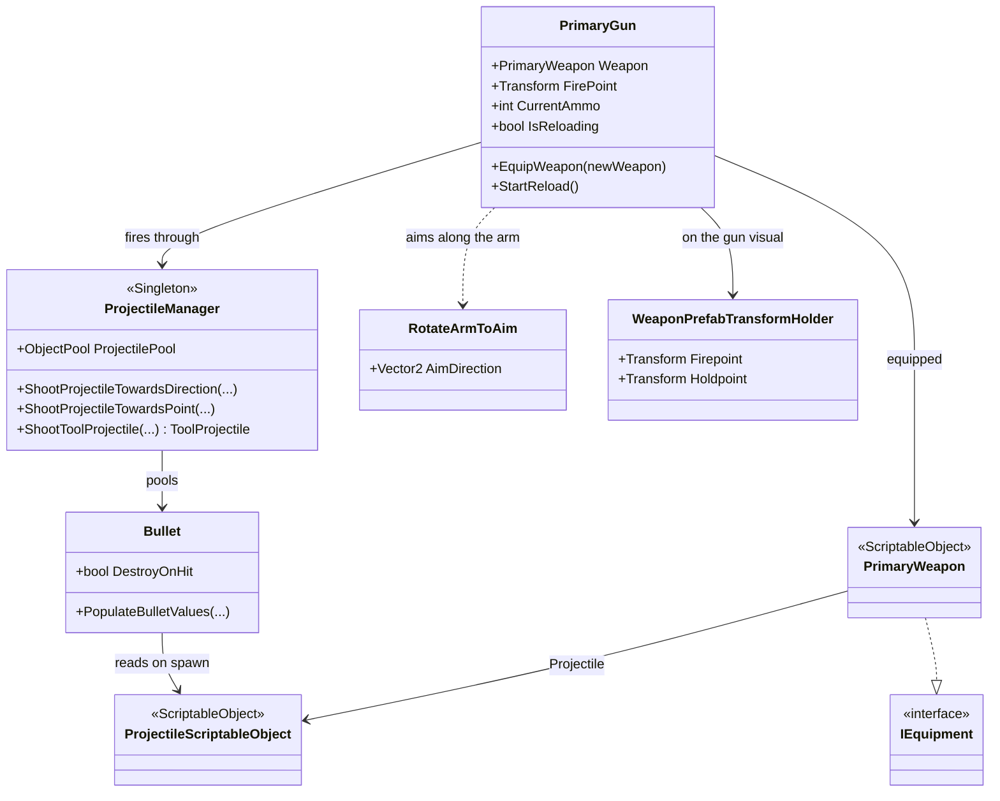
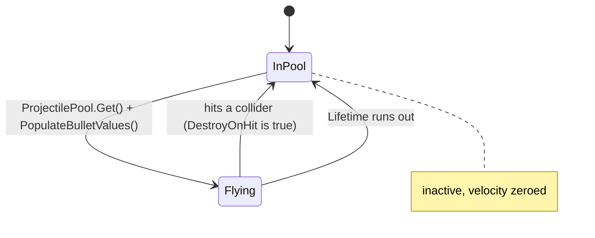

# Weapons and Projectiles

--8<-- "includes/2627-game/milestone.md"

The player's gun fires pooled bullets along the aiming arm. A gun is a `PrimaryWeapon` asset (ammo, spread, recoil), and each gun points at a `ProjectileScriptableObject` asset (damage, speed, sprite). `ProjectileManager` owns the one bullet pool, and boss attacks fire through it too. Player bullets and boss bullets are the same `Bullet` prefab with different data.

- **Folders:** [`Assets/Projectiles/`](https://github.com/PurdueSIGGD/SIGGD-Game-2026/tree/v0.1.0/Assets/Projectiles), [`Assets/Equipment/WeaponScripts/`](https://github.com/PurdueSIGGD/SIGGD-Game-2026/tree/v0.1.0/Assets/Equipment/WeaponScripts), [`Assets/Equipment/WeaponScriptableObjects/`](https://github.com/PurdueSIGGD/SIGGD-Game-2026/tree/v0.1.0/Assets/Equipment/WeaponScriptableObjects)
- **Namespace:** global
- **Tuning:** [guns](../tuning-guide.md#guns) and [projectiles](../tuning-guide.md#projectiles)

---

## How It's Put Together

On `Player.prefab`, `PrimaryGun` sits on the `WeaponHolder` object (next to `BombThrower` and `ToolUser`), and `RotateArmToAim` sits on `Arm Rotate Point`.

---

## How It Works

### Firing

`PrimaryGun` subscribes to `PlayerInputHandler.FirePressed`. Each press:

1. If there's no ammo, plays the "can't shoot" sound and stops.
2. Takes the aim direction as the line from the arm's pivot (`armRotatePoint`) to `FirePoint`, so the bullet leaves along the arm.
3. Fires `max(1, NumBullets)` bullets through `ProjectileManager.ShootProjectileTowardsDirection`. With one bullet, the bullet gets a random angle inside the `Spread` cone. With several, they're spaced evenly across `Spread`. Each bullet then turns by a random extra angle of up to `Offset` degrees either way.
4. Spends one ammo, regardless of bullet count.
5. Applies `Recoil` to the player's `Rigidbody2D` as an impulse opposite the aim.
6. Starts reloading.

### Reloading

Reloading is continuous. After any shot, a coroutine refills ammo at `AmmoCapacity / ReloadTime` rounds per second until the gun is full again, and you can keep firing during it. With the Pistol's 12 rounds and 10 s reload, that's 1.2 rounds per second.

### Equipping

`EquipWeapon(PrimaryWeapon)` swaps the asset, cancels any reload, refills ammo, and replaces the held gun visual. It instantiates the weapon's `WeaponVisualPrefab`, lines up that prefab's `Holdpoint` with the `WeaponHolder`, and takes the prefab's `Firepoint` as the new `FirePoint`. The [loadout menu](loadout.md) calls it, and so does `PrimaryGun.Start` for the gun set on the prefab.

### The Bullet Pool

`ProjectileManager` is a [singleton](infrastructure.md#singletons) that holds a Unity `ObjectPool<GameObject>` of the `BaseBullet` prefab. Firing takes a bullet from the pool and calls `PopulateBulletValues`, which copies everything from the projectile asset onto it: damage, lifetime, speed, sprite, color, scale, and the collider shape.

There is only one bullet prefab, so each bullet's look and shape come from the asset. The collider is a `PolygonCollider2D` rebuilt from the projectile sprite's physics shape, which Unity generates when it imports the sprite. The asset computes those outlines in `OnValidate` and stores them in `PhysicsPaths`.

### Layers: Who a Bullet Can Hit

Every shot passes two layer masks, `layerToHit` and `layerToIgnore`, which `Bullet` copies to its collider's `includeLayers` and `excludeLayers`. Because the project's collision matrix already lets every layer touch every other, `includeLayers` currently changes nothing. `layerToIgnore` does the real filtering.

| Shooter | `layerToIgnore` | Net effect |
|---|---|---|
| Player gun | `Player` | Hits everything except players. |
| Boss scrap fan | `Enemy`, `Boss` | Hits everything except the boss and the Enemy layer. |
| Boss bomb | `Boss` | Hits everything except the boss. |

Bullets are triggers. On contact, `Bullet` damages the other object if it's `IDamageable`, raises `OnBulletHit`, and returns to the pool if `DestroyOnHit` is true.

### Aiming

`RotateArmToAim` rotates the `Arm Rotate Point` toward `PlayerInputHandler.GetAimDirection` every frame. The gun fires along that arm, and [tools](tools.md) read its `AimDirection` property directly. For the visual-only arm on the character art, see [`PlayerAiming`](player.md#aiming).

### Spline Bullets (Work in Progress)

A projectile asset whose `SplineGameObject` has a `SplineContainer` gets `HasSpline` set, and its bullets follow the spline's knots instead of flying straight. The code marks this as unfinished and asks people not to touch it. `TestBullet` has leftover spline data, but its `SplineGameObject` is empty, so `OnValidate` turns `HasSpline` off.

---

## Class Reference

Fields with (Inspector) after their type are private `[SerializeField]`s.

### `PrimaryGun`

[`PrimaryGun.cs`](https://github.com/PurdueSIGGD/SIGGD-Game-2026/blob/v0.1.0/Assets/Projectiles/Scripts/PrimaryGun.cs): `MonoBehaviour`

| Member | Type | Description |
|---|---|---|
| `Weapon` | `PrimaryWeapon` | The equipped gun. |
| `FirePoint` | `Transform` | Where bullets spawn. Replaced by the gun visual's `Firepoint` on equip. |
| `PlayerBody` | `Rigidbody2D` | Receives recoil. |
| `CurrentAmmo` | `int` | Rounds left. |
| `IsReloading` | `bool` | True while the refill coroutine runs. |
| `armRotatePoint` | `Transform` (Inspector) | The arm pivot that sets the shot direction. |
| `enemyLayerMasks` | `LayerMask` (Inspector) | Passed as `layerToHit`. `Enemy` + `Boss` on the prefab. |
| `ignoreLayerMasks` | `LayerMask` (Inspector) | Passed as `layerToIgnore`. `Player` on the prefab. |
| `curWeaponVisual` | `GameObject` (Inspector) | The gun visual currently held. Replaced on every equip. |
| `EquipWeapon(PrimaryWeapon)` | method | Swap guns. Ignores `null`. |
| `StartReload()` | method | Start refilling if not full and not already reloading. Called after every shot. |

### `PrimaryWeapon`

[`PrimaryWeapon.cs`](https://github.com/PurdueSIGGD/SIGGD-Game-2026/blob/v0.1.0/Assets/Equipment/WeaponScripts/PrimaryWeapon.cs): `ScriptableObject`, `IEquipment`; **Create > Scriptable Objects > PrimaryWeapon**

Public fields: `Projectile`, `WeaponName`, `NumBullets`, `Spread`, `ReloadTime`, `Offset`, `Recoil`, `AmmoCapacity`, `FireSpeed`, `WeaponVisualPrefab`, `WeaponVisualRotationOffset`. The [Tuning Guide](../tuning-guide.md#guns) describes each. `Use()` from `IEquipment` is empty.

### `ProjectileScriptableObject`

[`ProjectileScriptableObject.cs`](https://github.com/PurdueSIGGD/SIGGD-Game-2026/blob/v0.1.0/Assets/Projectiles/ScriptableObjects/ProjectileScriptableObject.cs): `ScriptableObject`; **Create > Scriptable Objects > ProjectileScriptableObject**

Public fields: `IsExplosive`, `HasSpline`, `Damage`, `Lifetime`, `Velocity`, `SpriteAngleOffset`, `ProjectileSprite`, `ProjectileColor`, `ProjectileScale`, `SplineGameObject`, `SplineContainer`, `Spline`, `PhysicsPaths`. `HasSpline`, `SplineContainer`, `Spline`, and `PhysicsPaths` are filled in by `OnValidate`.

### `ProjectileManager`

[`ProjectileManager.cs`](https://github.com/PurdueSIGGD/SIGGD-Game-2026/blob/v0.1.0/Assets/Projectiles/Scripts/ProjectileManager.cs): `Singleton<ProjectileManager>`; prefab at `Assets/Projectiles/Prefabs/ProjectileManager.prefab`

| Member | Type | Description |
|---|---|---|
| `Instance` | `ProjectileManager` (static) | The manager, from `Singleton<T>`. |
| `ProjectilePool` | `ObjectPool<GameObject>` | The bullet pool. |
| `bulletPrefab` | `GameObject` (Inspector) | The prefab every pooled bullet is made from. |
| `ShootProjectileTowardsDirection(ProjectileScriptableObject, Transform firePoint, Vector2 direction, LayerMask layerToHit, LayerMask layerToIgnore)` | method | Fire one bullet from `firePoint` along `direction`. |
| `ShootProjectileTowardsPoint(ProjectileScriptableObject, Transform firePoint, Transform targetPoint, LayerMask layerToHit, LayerMask layerToIgnore)` | method | Fire one bullet from `firePoint` toward `targetPoint`. |
| `ShootToolProjectile(ToolProjectileData, Transform firePoint, Vector2 direction)` | `ToolProjectile` | Instantiate a [tool projectile](tools.md) (not pooled) and initialize it. |

### `Bullet`

[`Bullet.cs`](https://github.com/PurdueSIGGD/SIGGD-Game-2026/blob/v0.1.0/Assets/Projectiles/Scripts/Bullet.cs): `MonoBehaviour`; on `Assets/Projectiles/Bullets/BaseBullet.prefab`

| Member | Type | Description |
|---|---|---|
| `OnBulletHit` | `static UnityEvent<Bullet, GameObject>` | Raised on every hit with the bullet and what it hit. See Known Issues. |
| `DestroyOnHit` | `bool` | Return to the pool on the first hit. `true` by default. With `false`, the bullet pierces. |
| `PopulateBulletValues(ProjectileScriptableObject, Transform firePoint, Vector2 shootDirection, LayerMask layerToHit, LayerMask layerToIgnore)` | method | Reset the bullet and copy everything from the asset. Called by `ProjectileManager`. |
| `GetDamage()` / `SetDamage(int)` | method | Read or override this bullet's damage. |
| `GetLifetime()` / `SetLifetime(float)` | method | Read or override the seconds left. |
| `GetIsExplosive()` / `SetIsExplosive(bool)` | method | Read or override the explosive flag. |

### `RotateArmToAim`

[`RotateArmToAim.cs`](https://github.com/PurdueSIGGD/SIGGD-Game-2026/blob/v0.1.0/Assets/Equipment/WeaponScripts/RotateArmToAim.cs): `MonoBehaviour`

| Member | Type | Description |
|---|---|---|
| `AimDirection` | `Vector2` (get) | Normalized aim direction, updated every frame. Starts as `Vector2.right`. |
| `angleOffset` | `float` (Inspector) | Degrees added to the arm's rotation. `180` on the prefab. |

### `WeaponPrefabTransformHolder`

[`WeaponPrefabTransformHolder.cs`](https://github.com/PurdueSIGGD/SIGGD-Game-2026/blob/v0.1.0/Assets/Equipment/WeaponScripts/WeaponPrefabTransformHolder.cs): `MonoBehaviour`

Marks two points on a gun's visual prefab: `Firepoint` (where bullets spawn) and `Holdpoint` (where the hand grips it). Every `WeaponVisualPrefab` needs one on its root.

---

## Known Issues

- **No fire-rate limit.** The line that sets the next allowed fire time is inside a [commented-out block](https://github.com/PurdueSIGGD/SIGGD-Game-2026/blob/v0.1.0/Assets/Projectiles/Scripts/PrimaryGun.cs#L76), so `FireSpeed` does nothing and the gun fires as fast as you can click until ammo runs out.
- **The Shotgun asset isn't a gun.** `Assets/Equipment/WeaponScriptableObjects/Shotgun.asset` was created as a `ProjectileScriptableObject`, not a `PrimaryWeapon`, so it can't be equipped. The Pistol is the only working gun.
- **Bullets collide with each other.** Every bullet is on the `Default` layer, and no shot ignores `Default`. When two bullets touch, both return to the pool. That happens to cancel boss bullets the way the GDD wants, but pellets from a multi-bullet gun spawn overlapping and would destroy each other.
- **Bullets may have no collider in builds.** `PhysicsPaths` is a `List<Vector2[]>`, which Unity doesn't serialize. It's only filled by `OnValidate`, which only runs in the editor. In a player build the list would be empty, and `Bullet` would give the collider zero paths.
- **`Bullet.OnBulletHit` is never created.** The static event is declared but never assigned, so it's always `null` and calling `AddListener` on it throws.
- **The pool breaks on a scene reload.** `ProjectileManager` survives scene loads but its bullets don't. See [Shared Infrastructure](infrastructure.md#known-issues).
- **`IsExplosive` does nothing yet.** `Bullet.Update` has an empty branch where the explosion will go.
- **The Pistol has `NumBullets` set to `0`.** The code treats anything below 1 as 1.

### Differs from the GDD

- **Bullets hurt the boss and don't push players.** The [GDD](../../design/game-design-doc.md) says bullets only clear boss projectiles and break asteroids, and push a teammate they hit. At v0.1.0 bullets damage anything `IDamageable`, and since they're triggers, they push nothing.
- **Pistol cooldown.** The GDD gives the Pistol a half-second cooldown. See "No fire-rate limit" above.
